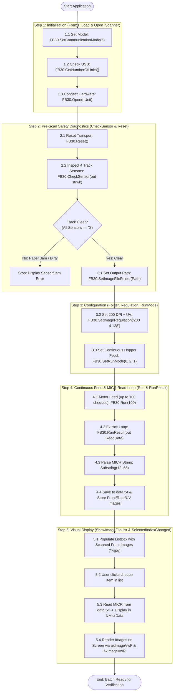

# ContinuousSample: Overall Step-by-Step Workflow

This document provides a clear, corrected, end-to-end explanation of how the **ContinuousSample** application works in practice, from opening the program to batch scanning, error handling, and closing the system.

---

## The Complete End-to-End Workflow

### Step 1: Launch & Hardware Model Selection
* **What happens:** 
  1. The user opens the application (`ContinuousSample.exe`).
  2. Before the main screen appears, a popup window (`dlgModel`) opens automatically, asking the operator to confirm or select their scanner model:
     * **FB-30** (High-speed multi-sensor check scanner)
     * **FB-20**
     * **FB-10 (USB)**
     * **FB-10 (LAN / Network)**
  3. Once selected and confirmed with **OK**, the application saves this choice into the Windows Registry (`Software\GLORY AZS\FB-30\CaptureSample\Model`).
  4. The main window opens, and the title bar updates to show the active model (for example: `Continuous Sample (FB-30)`).
  5. The program initializes the Glory driver in memory (`FB30 = new FB30()`). If the driver fails to initialize (e.g. missing driver DLLs), the buttons are immediately disabled.

---

### Step 2: Configuring Save Folder & Image Mode (One-Time Setup)
* **What happens:**
  1. The operator clicks **Setting $\rightarrow$ Image** from the top menu bar to open the image settings window (`dlgImage`).
  2. The operator configures two things:
     * **Image Type / Mode:**
       * `8 bit Gray` (Grayscale)
       * `24 bit Color` (Full color)
       * `8 bit Gray + UV` (Grayscale plus Ultraviolet image for watermark & counterfeit detection)
     * **Image Folder:** The directory on the computer's hard drive where scanned check images and MICR data files will be saved.
  3. When the user clicks **OK**, these settings are saved into the Windows Registry (`Software\GLORY AZS\FB-30\CaptureSample\Image`).

---

### Step 3: Starting the Batch & Hardware Connection Check
* **What happens:**
  1. The operator places a stack of checks (up to 100 checks) into the scanner's input tray (the hopper).
  2. The operator clicks the **"Start"** button on the screen.
  3. **Button Lock:** The application immediately locks/disables all UI buttons (`Start`, `Reset`, `Delete Files`, and `Setting` menu) so the operator cannot accidentally click anything while scanning is in progress.
  4. **Directory Validation:** It verifies that a valid image folder was selected. If the folder path is empty, it pops up an error: `"Please select image folder !!!"` and halts.
  5. **Hardware Connection Check (`Open_Scanner()`):**
     * The program sets the communication protocol based on the selected model (USB or LAN).
     * It checks how many scanner units are physically connected and powered on (`FB30.GetNumberOfUnits()`).
     * **If 0 scanners are detected:** It shows a Red error message: `"Cannot connect with FB scanner !!!"`, unlocks the buttons, and stops.
     * **If a scanner is detected:** It opens the hardware connection (`FB30.Open(nUnit)`). A return code of `0` indicates the scanner is successfully connected and ready.

---

### Step 4: Paper Jam Pre-Check (Optical Track Sensors)
* **What happens:**
  1. Before feeding any checks, the system resets the scanner state (`FB30.Reset()`).
  2. The system checks **4 optical sensors** positioned along the paper transport track (`FB30.CheckSensor()`).
  3. **Sensor Verification:**
     * If all 4 sensors report `'0'`, the track is completely clear.
     * If any sensor reports anything other than `'0'`, a check is already stuck inside from a previous run. The application halts immediately and displays in Red:
       `"Maybe paper exists on the document track !!! Please confirm each sensor."`
     * This safety check prevents the machine from feeding new paper into an already jammed track, protecting both the checks and the feeder rollers from mechanical damage.

---

### Step 5: Continuous Batch Scanning & Data Extraction
* **What happens:**
  1. **Configuring Rules:**
     * Sets the destination folder path: `FB30.SetImageFileFolder(strPath)`.
     * Sets the naming rule: `yyMMdd_HHmmss_%0001%?.jpg` (auto-numbers each check as `0001`, `0002`, etc., and automatically replaces `%?` with `F`, `R`, or `U`).
     * Sets scan resolution and color parameters: `"200 2 128"` (200 DPI Grayscale), `"200 3 128"` (Color), or `"200 4 128"` (UV).
  2. **Feeding the Checks:**
     * The command `FB30.Run(100)` activates the feeder motor.
     * The scanner pulls checks one by one from the hopper at high speed, feeding up to 100 checks continuously.
     * A native driver dialog (`DoMonitorDlg()`) appears on screen showing the real-time scanning progress bar.
  3. **Image Capture:**
     * For every single check that passes the optical camera heads, the hardware saves:
       * **Front Image (`*_F.jpg`)**
       * **Rear Image (`*_R.jpg`)** (for endorsements and signatures)
       * **UV Image (`*_U.jpg`)** (if UV mode is enabled, revealing ultraviolet security watermarks to detect counterfeit checks)
  4. **MICR Line Extraction:**
     * As each check passes over the magnetic reader head, the scanner decodes the **MICR line** (Magnetic Ink Character Recognition: routing number, bank account number, and check number).
     * The program opens `data.txt` in the image folder in append mode.
     * In a loop (`FB30.RunResult()`), the program retrieves each check's decoded MICR text and writes each line into `data.txt`.
  5. **Completion:**
     * When all checks pass through, the feeder stops.
     * The UI re-enables all buttons, updates the status message to `"Ready."` in Blue, and populates the check list on screen.

---

### Step 6: Operator Review & Simultaneous Dual Image Preview
* **What happens:**
  1. The left-hand ListBox (`ImageFile`) displays the filename of every scanned check (e.g., `261106_153000_0001F.jpg`).
  2. When the operator clicks on any check in the list:
     * **MICR Display:** The program reads `data.txt`, finds the line matching the selected check, extracts the 65 characters of magnetic ink data, and displays it in the `lvMicrData` label at the bottom.
     * **Front View:** The program loads the front image (`*_F.jpg`) into the top ActiveX viewer (`axImageVwF`).
     * **Rear / UV View:** The program automatically derives the rear image path by replacing `F.jpg` with `R.jpg` (or `U.jpg` if UV mode was selected) and loads it into the bottom ActiveX viewer (`axImageVwR`).
  3. The operator can clearly inspect both sides of the check simultaneously on a single screen without opening external image viewers.

---

### Step 7: Error Diagnostics (If Something Goes Wrong)
* **What happens:**
  * If an issue occurs during feeding, the scanner driver halts and returns an error code (`RC >= 2`).
  * The program immediately calls `FB30.GetDetailErrorInfo()` to retrieve the exact hardware telemetry and decodes it for the operator:
    * **Double Feed Error (Code 24):** Two checks were pulled into the rollers at the exact same time.
    * **Hopper Empty (Code 26 / RC = 1):** All checks have run through the feeder tray.
    * **Hopper Error (Code 27):** The tray lift elevator motor failed.
    * **Feeding Error (Code 32):** A paper jam occurred inside the transport rollers.
    * **Endorse Error (Code 40):** An issue with the rear ink stamper.
    * **Sensor Error (Code 60):** An internal optical glass or sensor is dirty, blocked, or defective.
    * **Communication Error (Code 73):** USB or LAN cable was unplugged mid-scan.
  * The error is displayed in bold Red on the screen, the buttons are re-enabled, and the scanner connection is safely closed.

---

### Step 8: Maintenance & Batch Reset
* **What happens:**
  1. **Resetting the Machine (`btnReset_Click`):**
     * If a paper jam or error occurred, the operator opens the scanner cover, removes the jammed check, closes the cover, and clicks **"Reset"**.
     * The application calls `FB30.Initialize()`, which resets the internal firmware flags, re-homes the feeder motors, and returns the machine to a `"Ready."` state.
  2. **Deleting Old Files (`btnDelete_Click`):**
     * When the operator has finished processing a batch and wants to start clean, they click **"Delete Files"**.
     * A confirmation dialog pops up: `"Delete Image Files ?"`.
     * Upon confirmation, the application permanently deletes all `.jpg` images and the `data.txt` file from the selected folder and clears the on-screen list.

---

### Step 9: Application Shutdown
* **What happens:**
  * When the operator closes the application window (`Form1_FormClosed`), the program automatically calls `Close_Scanner()`.
  * This sends a disconnect command (`FB30.Close()`), safely releasing the USB or LAN communication port so other applications or future sessions can use the scanner without requiring a machine reboot.

---

## Workflow Summary Table

| Phase | Operator Action | System / Hardware Action | On-Screen Result |
|:---|:---|:---|:---|
| **1. Startup** | Launches `ContinuousSample.exe` | Shows `dlgModel` popup; reads Registry; initializes `FB30` driver | Window title shows active model: `(FB-30)` |
| **2. Settings** | Clicks **Setting $\rightarrow$ Image** | Opens `dlgImage`; user picks folder and image mode (Gray/Color/UV) | Settings saved to Registry |
| **3. Pre-Scan** | Places checks in hopper, clicks **Start** | Disables UI buttons; runs `Open_Scanner()` (checks USB/LAN connection) | Status: `"Prepairing..."` (Green) |
| **4. Safety Check** | None (automatic) | Queries 4 paper track sensors (`CheckSensor`) to ensure no check is stuck | If jammed: `"Maybe paper exists on document track"` (Red) |
| **5. Continuous Scan** | None (automatic) | `FB30.Run(100)` feeds up to 100 checks; captures Front, Rear, and UV images | Driver progress bar dialog appears |
| **6. Data Logging** | None (automatic) | `FB30.RunResult()` extracts decoded MICR lines and appends to `data.txt` | Images written to disk; `data.txt` created |
| **7. Completion** | None (automatic) | Refreshes ListBox with `*F.jpg` files; re-enables buttons | Status: `"Ready."` (Blue) |
| **8. Review** | Clicks a check in the ListBox | Reads MICR from `data.txt`; loads Front image in top viewer, Rear/UV in bottom viewer | Dual image preview + full MICR string displayed |
| **9. Reset** | Clicks **Reset** | Calls `FB30.Initialize()` to clear error locks and re-home stepper motors | Status: `"Ready."` (Blue) |
| **10. Cleanup** | Clicks **Delete Files** | Confirms with user, then deletes all `.jpg` and `.txt` files in the folder | ListBox cleared; folder wiped clean |
| **11. Exit** | Clicks **X** (close window) | Calls `Close_Scanner()` (`FB30.Close()`) to release USB/LAN ports | Application exits cleanly |

---

## File Structure & Component Roles

| File Name | Purpose & Description |
| :--- | :--- |
| **`CommonContents.cs`** | **Constant Definition Class:** Contains shared constants: Model indices (`MODEL_FB30 = 0`, `MODEL_FB20 = 1`, `MODEL_FB10_USB = 2`, `MODEL_FB10_LAN = 3`), UI status colors (`BLUE = 0`, `GREEN = 1`, `RED = 2`, `ORANGE = 3`), and Windows Registry paths (`REG_IMAGE_PATH`, `REG_MODEL_PATH`). Contains **no** business logic methods. |
| **`dlgModel.cs`** | **Model Selection Dialog:** Prompts the operator to select the scanner model and saves the selection to the Windows Registry. |
| **`dlgImage.cs`** | **Image Settings Dialog:** Allows the user to select the destination folder and choose the image capture mode (Grayscale, Color, Grayscale + UV). |
| **`Form1.cs`** | **Core Scanner Engine:** Orchestrates device lifecycle, pre-scan sensor track inspection, image/MICR configuration, continuous batch feeding, MICR data extraction, and hardware error diagnostics. |
| **`Program.cs`** | **Application Entry Point:** Enables Windows visual styles and launches `Form1`. |
| **`Form1.Designer.cs`** | Auto-generated UI initialization code configuring controls, buttons, list boxes, and ActiveX image view controls (`axImageVwF`, `axImageVwR`). |
| **`ContinuousSample.csproj`** | Project configuration file targeting 32-bit `x86` architecture and linking COM references (`FB4API3Lib`, `AxIMAGEVWLib`). |

---

## End-to-End Workflow Diagram

The following Mermaid diagram outlines the complete 5-step operational workflow from hardware connection to visual cheque verification:

---

## Detailed Step-by-Step Workflow Explanation

### Step 1: Initialization & Device Connection (`Form1_Load` & `Open_Scanner`)
* **Communication Mode:** The application reads the selected model from the Windows Registry (`REG_MODEL_PATH`). For the **FB-30**, it sets internal communication mode to `5` via `FB30.SetCommunicationMode(5)`.
* **USB Detection:** Calls `FB30.GetNumberOfUnits()` to ensure at least one scanner is connected.
* **Hardware Connection:** Calls `FB30.Open(nUnit)`. When return code `RC == 0`, connection succeeds and `m_bOpen = true`.

### Step 2: Pre-Scan Safety Diagnostics (`CheckSensor` & `Reset`)
* **Transport Reset:** Calls `FB30.Reset()` to clear roller states.
* **Sensor Health Check:** Calls `FB30.CheckSensor(out strwk)` to read the 4 physical track sensors (e.g., `"0000"`).
* **Paper Jam Prevention:** If any sensor character is not `'0'`, a cheque is jammed or a sensor is dirty. The program halts with `"Maybe paper exists on the document track!"` to protect the hardware and instruments.

### Step 3: Scan Configuration (`SetImageFileFolder`, `SetImageRegulation`, `SetRunMode`)
* **Save Directory:** `FB30.SetImageFileFolder(strPath)` sets the destination directory.
* **Naming Template:** `FB30.SetImageFileName("yyMMdd_HHmmss_%0001%?.jpg")` defines the filename structure. The driver automatically generates:
  * `*F.jpg` = Front Image
  * `*R.jpg` = Rear Image
  * `*U.jpg` = UV Image
* **Resolution & UV:** `FB30.SetImageRegulation("200 4 128")` configures **200 DPI resolution**, mode `4` (**Grayscale + UV**), and brightness `128`.
* **Feed Mode:** `FB30.SetRunMode(0, 2, 1)` enables **Continuous Hopper Feeding** (Mode `2`) and pocket routing `1`.

### Step 4: Continuous Feed & MICR Read Loop (`Run` & `RunResult`)
* **Batch Motor Activation:** `FB30.Run(100)` activates the feeder, pulling up to 100 cheques continuously through the magnetic read head and cameras.
* **Progress Dialog:** `FB30.DoMonitorDlg()` displays a modal progress indicator until the hopper is empty (`RC == 1`).
* **MICR Line Extraction:** Loops `FB30.RunResult(out ReadData)`:
  * `ReadData` contains the raw hardware telemetry and decoded E-13B magnetic characters.
  * `ReadData.Substring(12, 65)` extracts the clean 65-character MICR line containing **Cheque No, Drawee Routing No, Drawer Account No, and Tran Code**.
  * Each extracted MICR line is written to `data.txt`.

### Step 5: Visual Display & Verification (`ShowImageFileList` & `ImageFile_SelectedIndexChanged`)
* **File Ingestion:** `ShowImageFileList()` scans the folder for `*F.jpg` files and populates the `ImageFile` ListBox.
* **Cheque Inspection:** When an item is selected:
  1. `get_micr_data()` retrieves the corresponding MICR codeline from `data.txt` and displays it in `lvMicrData`.
  2. Finds matching Front (`*F.jpg`) and Rear/UV (`*R.jpg` or `*U.jpg`) files.
  3. Invokes `axImageVwF.SetImageFile()` and `axImageVwR.SetImageFile()` to render the cheque images on screen.

---

## Hardware Error Diagnostics & Return Codes

When an operation returns a non-zero code, `ShowError(RC)` queries `FB30.GetDetailErrorInfo()` to decode the issue:

| Error Category | Code | Description & Operational Resolution |
| :--- | :--- | :--- |
| **Driver Status** | `RC == 0` | **Ready / Success:** Operation completed normally. |
| **Driver Status** | `RC == 1` | **Hopper Empty:** Feeder out of cheques; batch scan complete. |
| **Driver Status** | `RC >= 2` | **Hardware / Parameter Error:** Detailed diagnosis required. |
| **Hardware Error** | `Code 24` | **Double Feed Error:** Multiple cheques pulled at once. Separate and re-feed. |
| **Hardware Error** | `Code 26 / 27` | **Hopper Error:** Feeder elevator or separation roller failure. |
| **Hardware Error** | `Code 32` | **Feeding Error / Paper Jam:** Cheque stuck in track. Clear document path. |
| **Hardware Error** | `Code 40` | **Endorse Error:** Rear endorsement stamp printer malfunction. |
| **Hardware Error** | `Code 50` | **Image Handling Error:** Camera sensor buffer fault. |
| **Hardware Error** | `Code 60` | **Sensor Error:** Optical track sensor dirty or blocked. |
| **Hardware Error** | `Code 73` | **Communication Error:** USB cable disconnected or communication lost. |
