# Software Requirement Specification for ACE CTS

**Confidentiality:** ACE CONFIDENTIAL  
**Submitted To:** [Bank Name]  
**Submitted By:** [Vendor Name / ACE Technology]  
**Reference No:** ACECTS-SRS-001  
**Version:** 1.0  
**Date:** 08-06-2026

## Review Summary

This document defines the functional and nonfunctional requirements for ACE CTS. Screenshots are captured from the current ACE CTS application and are indicative and subject to change. Final external interface, infrastructure, security, and operational procedures shall be agreed with the Bank.

## Revision History

| Release Date DD-MM-YY | Revision Number x.y | Changes Made (Mention Sections Affected) | Author | Reviewed By [Name and org Role] | Approved By [Name and org Role] |
| --- | --- | --- | --- | --- | --- |
| 08-06-26 | 1.0 | First Draft for ACE CTS | [Author Name] | [Reviewer Name / Role] | [Approver Name / Role] |

## Table of Contents

1. Introduction  
2. Overall Description  
3. Solution Features  
4. External Interface Requirements  
5. Other Nonfunctional Requirements  
6. Appendix A: Deployment Diagram  
7. Appendix B: Open Items  
8. Appendix C: Integration Touch Points  
9. Appendix D: List of Reject Reasons  
10. Appendix E: Account Types and Status  
11. Appendix F: New Reports  
12. User Listing Requirement

## 1. Introduction

### 1.1 Purpose
The purpose of this Software Requirement Specification is to define ACE CTS functional, interface, workflow, reporting, administration, audit, security, and nonfunctional requirements for cheque truncation processing.

### 1.2 Solution Scope
ACE CTS shall support outward cheque capture, maker-checker authorization, ICL file generation, Clearing House / CBM response processing, NAK repair, return handling, posting, inward ICL import, technical verification, referral, manual return, return upload processing, reporting, search, archival, administration, audit trail, and deployment planning.

### 1.3 Abbreviations
| Abbreviation | Description |
| --- | --- |
| ACE CTS | ACE Cheque Truncation System |
| CBS | Core Banking System |
| CBM | Central Bank / Clearing House authority |
| ICL | Image Cash Letter |
| IQA | Image Quality Analysis |
| MICR | Magnetic Ink Character Recognition |
| NAK | Negative acknowledgement |
| CPC | Central Processing Centre |
| DR | Disaster Recovery |

### 1.4 Document Conventions
The word "shall" indicates a mandatory requirement. Screenshots are indicative and subject to change. Interface details marked as open shall be finalized with the Bank.

### 1.5 Intended Audience
The intended audience includes Bank business users, operations users, IT administrators, information security, audit, project management, implementation teams, and ACE Technology.

### 1.6 Overview
ACE CTS shall provide controlled processing of outward and inward clearing items through role-based queues, formal validations, audit trail, file exchange touch points, and reporting.

### 1.7 References
- Bank clearing operating procedures.
- Clearing House / CBM ICL and response specifications to be finalized.
- Bank CBS interface and posting specifications to be finalized.
- Bank information security, audit, and retention policies.

## 2. Overall Description

### 2.1 Solution Flow
ACE CTS shall route instruments through outward and inward workflows based on validation result, maker-checker decision, Clearing House / CBM response, return status, and posting completion.

### 2.1.1 ACE CTS Outward Process Flow
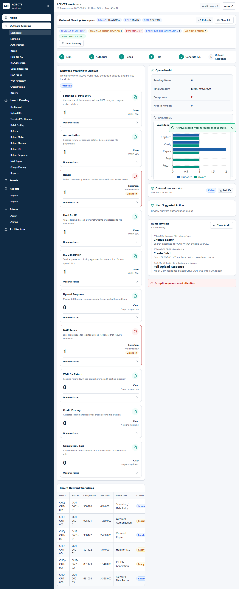

*Figure 12: ACE CTS Outward Process Flow (Indicative and subject to change)*

### 2.1.2 ACE CTS Inward Process Flow
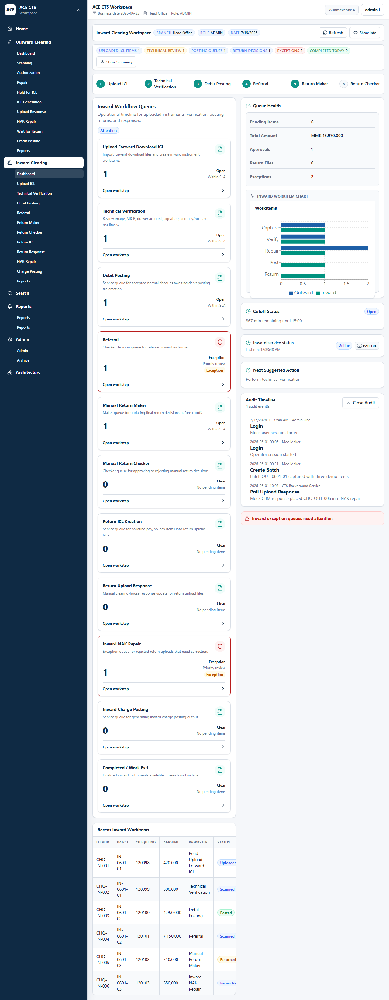

*Figure 32: ACE CTS Inward Process Flow (Indicative and subject to change)*

### 2.2 User Classes and Characteristics
| User Class | Characteristics |
| --- | --- |
| MAKER | Outward scanning, outward repair, technical verification, manual return maker, outward NAK repair, inward NAK repair, upload ICL |
| CHECKER | Outward authorization, referral, manual return checker |
| ADMIN | All functional pages, admin settings, audit trail, archive, reset, role and queue management |
| SERVICE | Background service identity for scheduled audit events and interface processing |

### 2.3 Operating Environment
ACE CTS shall operate as a secure web-based solution accessible to authorized branch, CPC, operations, service, and administrator users through Bank-approved network and endpoint controls.

### 2.4 Deliverables
ACE CTS deliverables shall include application modules, configuration, user/role setup, reports, external interface configuration, deployment documentation, operational procedures, and test evidence.

### 2.5 Assumptions, Dependencies and Constraints
- Final CBS, scanner, Clearing House / CBM, security, infrastructure, HA, DR, and archival specifications shall be confirmed with the Bank.
- ACE CTS shall enforce maker-checker segregation according to Bank policy.
- Clearing deadlines, cutoff times, reject reasons, representment rules, and routing numbers shall be configurable.

## 3. Solution Features

### 3.1 Login Page

**Description**  
ACE CTS shall provide a secure login page for authenticated access to authorized functions.

**Screenshot / Figure**  
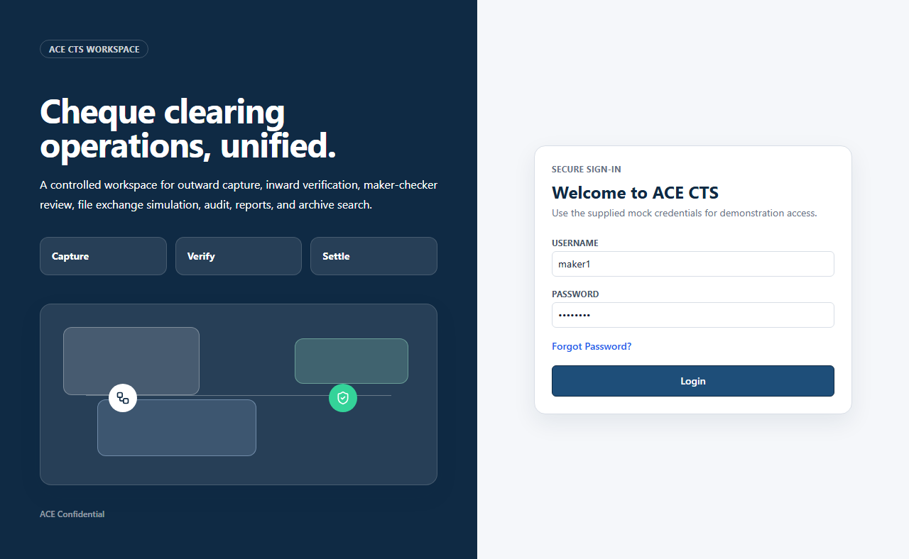

*Figure 1: ACE CTS Login Page (Indicative and subject to change)*

**Priority**  
High

**Integration Touch Point**  
ACE CTS shall validate user credentials against the Bank-approved identity source. Interface specifications shall be finalized with the Bank.

**Functional Requirement**  
ACE CTS shall provide the Login Page function as described in this section and shall enforce the applicable workflow, validation, audit, and role controls.

**Actors**  
All active users

**Field Details / Control Behaviour**  
| S. No. | Field Name | Field Type | Control Behaviour | Mandatory | Remarks |
| --- | --- | --- | --- | --- | --- |
| 1 | Username | Text | Editable | Yes | User login identifier |
| 2 | Password | Password | Editable / masked | Yes | User password |
| 3 | Forgot Password | Action link | Selectable | No | Initiates password assistance process |

**Options / Buttons**  
| S. No. | Option / Button | Behaviour | Validation / Confirmation | Target Work-step |
| --- | --- | --- | --- | --- |
| 1 | Login | Authenticates the user and opens the authorized landing page | Invalid credentials shall show an alert | Role-based dashboard |

**Validation Rules**  
Username and password shall be required. Invalid credentials shall not create a session.

**Confirmation Messages**  
ACE CTS shall display confirmation messages before committing irreversible or workflow-moving actions where indicated in the options table.

**Target Work-step(s)**  
| Routing Criteria | Target Work-step |
| --- | --- |
| Valid login | Authorized dashboard |
| Invalid login | Login page with alert |

**Audit Trail Requirement**  
Successful and unsuccessful access attempts shall be auditable subject to Bank security policy.

### 3.2 Logout

**Description**  
ACE CTS shall provide user menu options for password change and logout.

**Screenshot / Figure**  
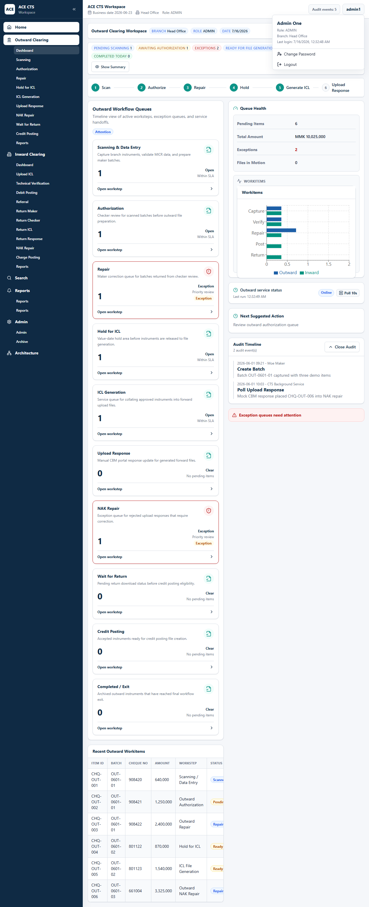

*Figure 3: ACE CTS User Menu with Logout and Change Password Options (Indicative and subject to change)*

**Priority**  
High

**Integration Touch Point**  
ACE CTS shall support integration with the Bank session management policy.

**Functional Requirement**  
ACE CTS shall provide the Logout function as described in this section and shall enforce the applicable workflow, validation, audit, and role controls.

**Actors**  
Authenticated users

**Field Details / Control Behaviour**  
| S. No. | Field Name | Field Type | Control Behaviour | Mandatory | Remarks |
| --- | --- | --- | --- | --- | --- |
| 1 | User Name | Display | Read-only | No | Shows logged-in user |
| 2 | Role | Display | Read-only | No | Shows assigned role |
| 3 | Branch | Display | Read-only | No | Shows assigned branch |

**Options / Buttons**  
| S. No. | Option / Button | Behaviour | Validation / Confirmation | Target Work-step |
| --- | --- | --- | --- | --- |
| 1 | Change Password | Opens password change page | None | Change Password |
| 2 | Logout | Clears session and returns user to login | Session shall be ended | Login Page |

**Validation Rules**  
Logout shall terminate the active session and prevent protected page access without re-authentication.

**Confirmation Messages**  
ACE CTS shall display confirmation messages before committing irreversible or workflow-moving actions where indicated in the options table.

**Target Work-step(s)**  
| Routing Criteria | Target Work-step |
| --- | --- |
| Logout selected | Login Page |

**Audit Trail Requirement**  
Logout shall be captured in audit trail.

### 3.3 Change Password

**Description**  
ACE CTS shall allow a user to change his or her password after successful login.

**Screenshot / Figure**  
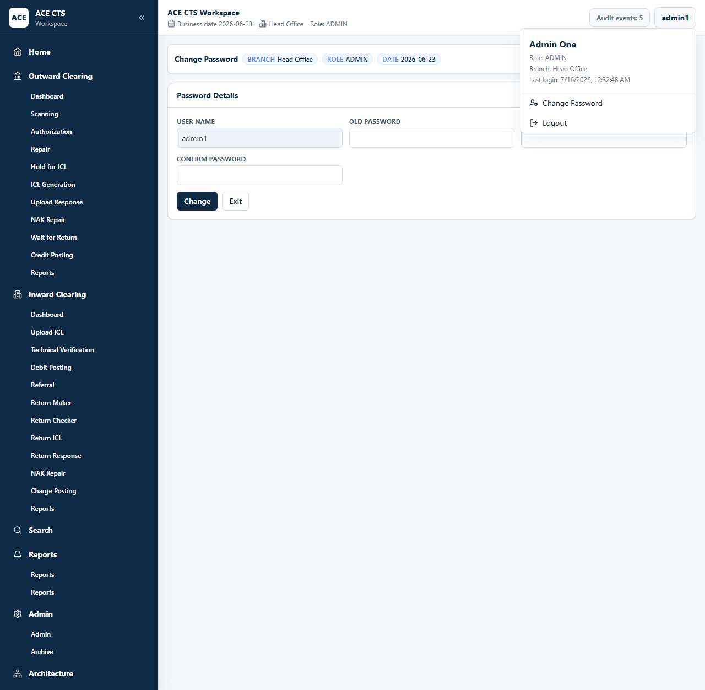

*Figure 4: ACE CTS Change Password Page (Indicative and subject to change)*

**Priority**  
High

**Integration Touch Point**  
ACE CTS shall apply the Bank password policy and identity-management interface when finalized.

**Functional Requirement**  
ACE CTS shall provide the Change Password function as described in this section and shall enforce the applicable workflow, validation, audit, and role controls.

**Actors**  
Authenticated users

**Field Details / Control Behaviour**  
| S. No. | Field Name | Field Type | Control Behaviour | Mandatory | Remarks |
| --- | --- | --- | --- | --- | --- |
| 1 | User Name | Text | Disabled | No | Current user |
| 2 | Old Password | Password | Editable | Yes | Existing password |
| 3 | New Password | Password | Editable | Yes | New password |
| 4 | Confirm Password | Password | Editable | Yes | Must match new password |

**Options / Buttons**  
| S. No. | Option / Button | Behaviour | Validation / Confirmation | Target Work-step |
| --- | --- | --- | --- | --- |
| 1 | Change | Submits password change | New and confirm password must match | Dashboard |
| 2 | Exit | Leaves page without change | None | Dashboard |

**Validation Rules**  
Old password shall be verified. New password and confirmation shall match before update.

**Confirmation Messages**  
ACE CTS shall display confirmation messages before committing irreversible or workflow-moving actions where indicated in the options table.

**Target Work-step(s)**  
| Routing Criteria | Target Work-step |
| --- | --- |
| Password changed | Dashboard |
| Validation failed | Change Password Page |

**Audit Trail Requirement**  
Password change shall create an audit event without storing password values.

### 3.4 Outward Process
### 3.4.1 Outward Dashboard & Menu

**Description**  
ACE CTS shall display outward workitem counts, workflow tiles, process navigation, and current work queues.

**Screenshot / Figure**  

*Figure 12: ACE CTS Outward Process Flow (Indicative and subject to change)*

**Priority**  
High

**Integration Touch Point**  
ACE CTS shall present operational queue data from the application database.

**Functional Requirement**  
ACE CTS shall provide the Outward Dashboard & Menu function as described in this section and shall enforce the applicable workflow, validation, audit, and role controls.

**Actors**  
Maker, Checker, Admin

**Field Details / Control Behaviour**  
| S. No. | Field Name | Field Type | Control Behaviour | Mandatory | Remarks |
| --- | --- | --- | --- | --- | --- |
| 1 | Workitem Count | Display tile | Read-only | No | Shows queue count by work-step |
| 2 | Recent Workitems | Grid | Read-only | No | Shows outward items |
| 3 | Workitems Chart | Chart | Read-only | No | Shows queue trend by category |

**Options / Buttons**  
| S. No. | Option / Button | Behaviour | Validation / Confirmation | Target Work-step |
| --- | --- | --- | --- | --- |
| 1 | Workflow Tile | Opens selected outward work-step | Role access applies | Selected queue |

**Validation Rules**  
Dashboard counts shall refresh when workitems move between workflow stages.

**Confirmation Messages**  
ACE CTS shall display confirmation messages before committing irreversible or workflow-moving actions where indicated in the options table.

**Target Work-step(s)**  
| Routing Criteria | Target Work-step |
| --- | --- |
| Tile selected | Selected outward work-step |

**Audit Trail Requirement**  
Dashboard access may be logged according to Bank audit policy.

### 3.4.2 Scanning and Data Entry

**Description**  
ACE CTS shall capture outward cheque images, create batches, fetch credit account details, validate MICR and amount data, and submit valid batches to authorization.

**Screenshot / Figure**  
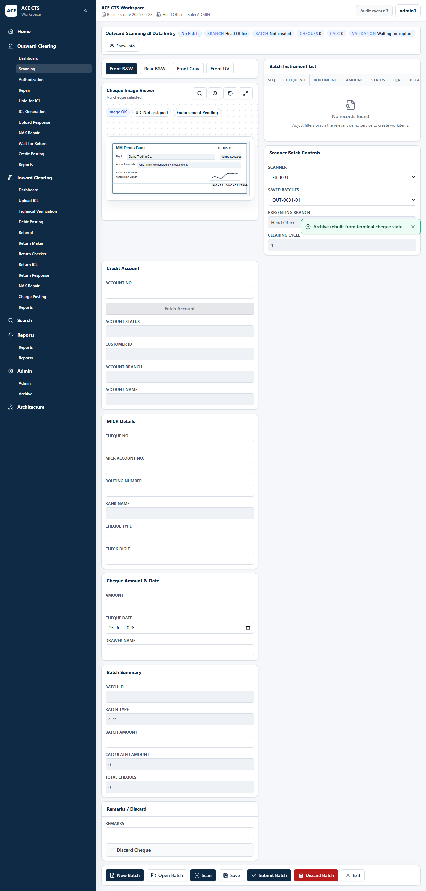

*Figure 13: ACE CTS Scanning and Data Entry Screen without Data (Indicative and subject to change)*

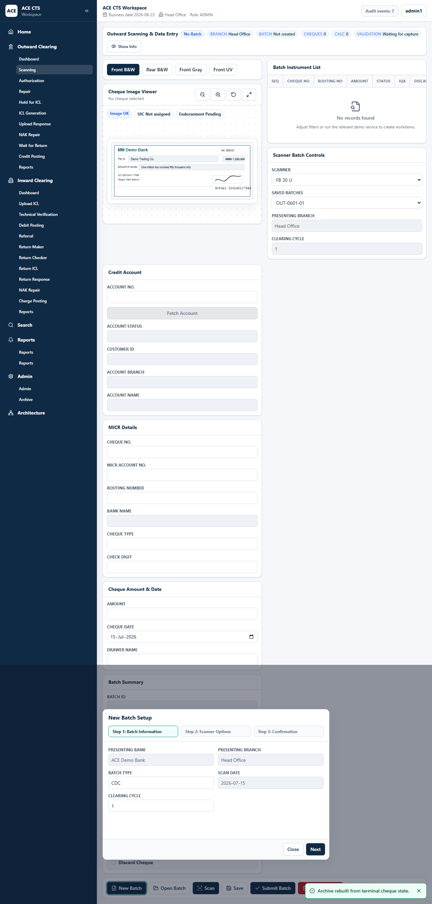

*Figure 14: ACE CTS New Batch Window (Indicative and subject to change)*

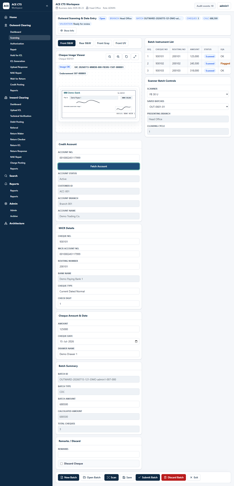

*Figure 15: ACE CTS Scanning and Data Entry Screen with Cheques (Indicative and subject to change)*

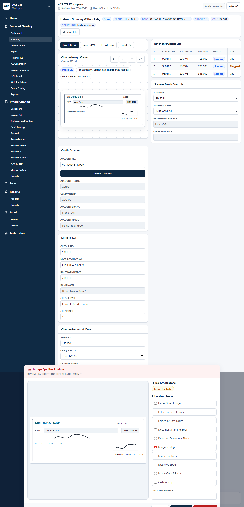

*Figure 16: ACE CTS Image Quality Analysis Window (Indicative and subject to change)*

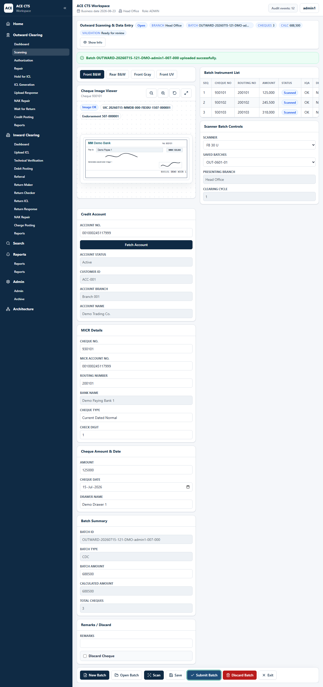

*Figure 17: ACE CTS Batch Upload Success Message (Indicative and subject to change)*

**Priority**  
High

**Integration Touch Point**  
ACE CTS shall integrate with cheque scanners and CBS. Scanner, CBS, and endorsement specifications shall be finalized with the Bank.

**Functional Requirement**  
ACE CTS shall provide the Scanning and Data Entry function as described in this section and shall enforce the applicable workflow, validation, audit, and role controls.

**Actors**  
Maker, Admin

**Field Details / Control Behaviour**  
| S. No. | Field Name | Field Type | Control Behaviour | Mandatory | Remarks |
| --- | --- | --- | --- | --- | --- |
| 1 | Account No. | Text | Editable | Yes | Credit account number |
| 2 | Account Status / Customer ID / Branch / Name | Display | Disabled | No | Returned by CBS lookup |
| 3 | Cheque No. | Text | Editable | Yes | MICR cheque number |
| 4 | MICR Account No. | Text | Editable | Yes | MICR account number |
| 5 | MICR Routing Number | Text | Editable | Yes | Routing number |
| 6 | Amount | Amount | Editable | Yes | Cheque amount |
| 7 | Cheque Date | Date | Editable | Yes | Issue date |
| 8 | Drawer Name / Remarks | Text | Editable | Conditional | Drawer and exception notes |
| 9 | Batch Amount | Amount | Editable | Yes | Must match calculated amount |
| 10 | Scanner | List | Selectable | Yes | Scanner station selection |

**Options / Buttons**  
| S. No. | Option / Button | Behaviour | Validation / Confirmation | Target Work-step |
| --- | --- | --- | --- | --- |
| 1 | New Batch | Creates a new outward batch | Batch details required | Scanning |
| 2 | Scan | Captures cheque images | Batch must be open | Scanning |
| 3 | Fetch Account | Retrieves credit account details | Account must exist and be valid | Scanning |
| 4 | Submit | Validates and uploads batch | IQA, duplicate, stale, in-house, routing, and amount checks | Outward Authorization |
| 5 | Save and Close | Stores draft batch | None | Scanning |
| 6 | Discard Batch | Marks batch cheques discarded | Remarks required for discarded items | Discard |

**Validation Rules**  
ACE CTS shall validate duplicate cheques, stale cheques, in-house cheques, representment rules, routing number format, junk MICR characters, image quality flags, account fetch completion, and batch amount balancing.

**Confirmation Messages**  
ACE CTS shall display confirmation messages before committing irreversible or workflow-moving actions where indicated in the options table.

**Target Work-step(s)**  
| Routing Criteria | Target Work-step |
| --- | --- |
| Valid batch submitted | Outward Authorization |
| Discard selected | Discard / archive |
| Validation failed | Scanning and Data Entry |

**Audit Trail Requirement**  
Batch creation, scan, account fetch, save, discard, IQA handling, and submit shall be audited.

### 3.4.3 Outward Authorization

**Description**  
ACE CTS shall provide FIFO checker review of submitted outward batches with image viewer, account data, cheque details, and maker-checker controls.

**Screenshot / Figure**  

*Figure 18: ACE CTS Outward Authorization Search (Indicative and subject to change)*

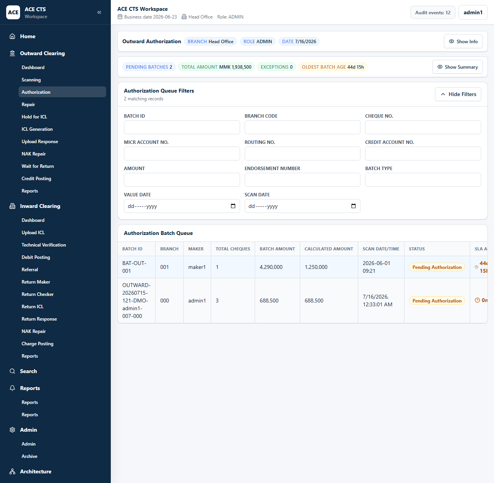

*Figure 19: ACE CTS Outward Authorization Detail (Indicative and subject to change)*

*Figure 20: ACE CTS Outward Authorization Confirmation (Indicative and subject to change)*

**Priority**  
High

**Integration Touch Point**  
ACE CTS shall maintain maker-checker controls through the user and queue access model.

**Functional Requirement**  
ACE CTS shall provide the Outward Authorization function as described in this section and shall enforce the applicable workflow, validation, audit, and role controls.

**Actors**  
Checker, Admin

**Field Details / Control Behaviour**  
| S. No. | Field Name | Field Type | Control Behaviour | Mandatory | Remarks |
| --- | --- | --- | --- | --- | --- |
| 1 | Search Criteria | Text/date fields | Editable | No | Batch, branch, cheque, MICR, routing, account, amount, endorsement, type, value date, scan date |
| 2 | Credit Account Details | Display | Disabled | No | Account values |
| 3 | Cheque Details | Display/edit by permission | Disabled for authorization | No | Cheque data under review |
| 4 | Batch Details | Display | Disabled | No | Batch balancing details |

**Options / Buttons**  
| S. No. | Option / Button | Behaviour | Validation / Confirmation | Target Work-step |
| --- | --- | --- | --- | --- |
| 1 | Authorize Batch | Accepts batch | Confirmation required and maker-checker restriction applies | Hold for ICL File Generation |
| 2 | Repair Batch | Sends batch to maker repair | Confirmation required | Outward Repair |
| 3 | Discard Batch | Discards batch | Confirmation required | Discard |
| 4 | Exit | Leaves page | Confirmation required | Dashboard |

**Validation Rules**  
The same maker shall not authorize his or her own batch unless Bank policy allows an administrator override.

**Confirmation Messages**  
ACE CTS shall display confirmation messages before committing irreversible or workflow-moving actions where indicated in the options table.

**Target Work-step(s)**  
| Routing Criteria | Target Work-step |
| --- | --- |
| Authorized | Hold for ICL File Generation |
| Repair requested | Outward Repair |
| Discarded | Discard |

**Audit Trail Requirement**  
Authorization, repair return, and discard decisions shall be audited.

### 3.4.4 Outward Repair

**Description**  
ACE CTS shall allow makers to correct checker-returned outward batches and send them back for authorization.

**Screenshot / Figure**  

*Figure 21: ACE CTS Outward Repair Search (Indicative and subject to change)*

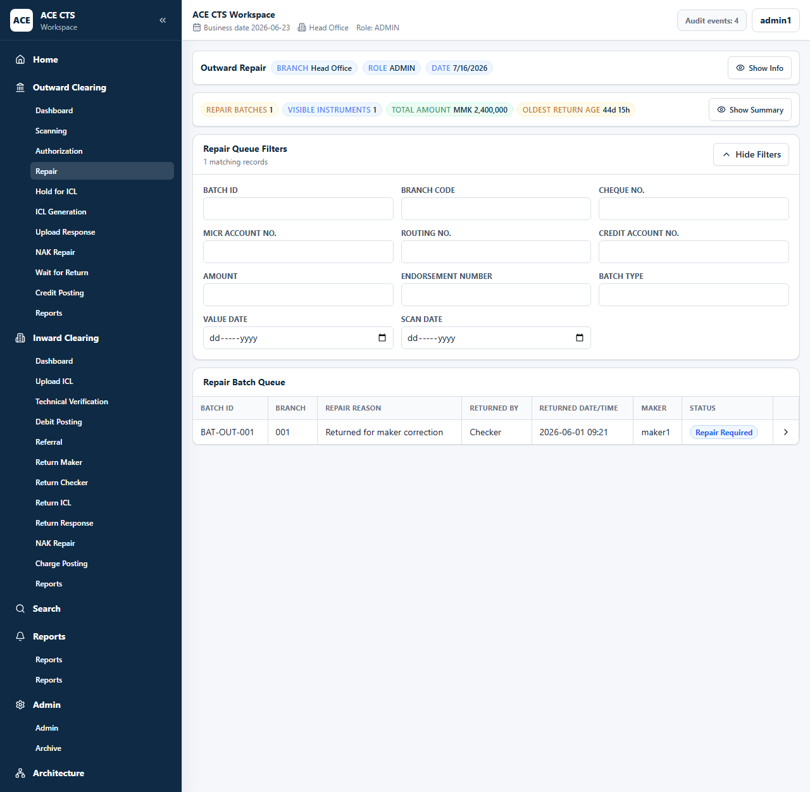

*Figure 22: ACE CTS Outward Repair Detail (Indicative and subject to change)*

**Priority**  
High

**Integration Touch Point**  
ACE CTS shall retain original and repaired values for audit review where required.

**Functional Requirement**  
ACE CTS shall provide the Outward Repair function as described in this section and shall enforce the applicable workflow, validation, audit, and role controls.

**Actors**  
Maker, Admin

**Field Details / Control Behaviour**  
| S. No. | Field Name | Field Type | Control Behaviour | Mandatory | Remarks |
| --- | --- | --- | --- | --- | --- |
| 1 | Search Criteria | Text/date fields | Editable | No | Batch and cheque filters |
| 2 | Cheque Details | Text/date/checkbox | Editable | As applicable | Correctable fields |
| 3 | Remarks | Text | Editable | Conditional | Repair note |

**Options / Buttons**  
| S. No. | Option / Button | Behaviour | Validation / Confirmation | Target Work-step |
| --- | --- | --- | --- | --- |
| 1 | Complete | Completes repair and routes batch back | No-change confirmation if no data changed | Outward Authorization |
| 2 | Exit | Leaves repair page | Confirmation required | Dashboard |

**Validation Rules**  
ACE CTS shall require confirmation when repair is completed without field changes.

**Confirmation Messages**  
ACE CTS shall display confirmation messages before committing irreversible or workflow-moving actions where indicated in the options table.

**Target Work-step(s)**  
| Routing Criteria | Target Work-step |
| --- | --- |
| Repair complete | Outward Authorization |

**Audit Trail Requirement**  
Repair completion and changed-field status shall be audited.

### 3.4.5 Hold for ICL File Generation

**Description**  
ACE CTS shall hold authorized outward instruments until the value date is due for ICL generation.

**Screenshot / Figure**  
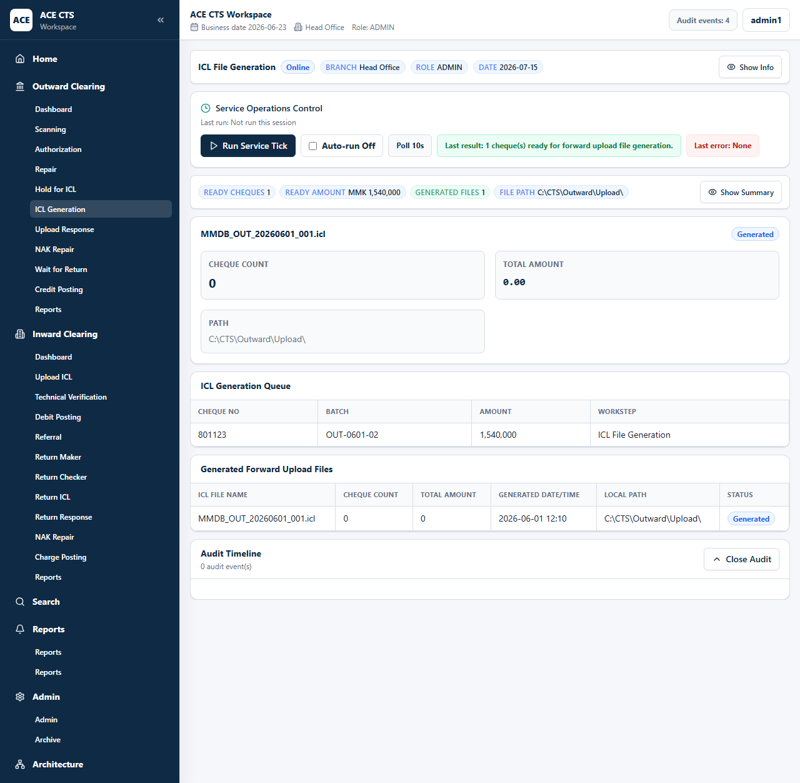

*Figure 23: ACE CTS Hold for ICL File Generation (Indicative and subject to change)*

**Priority**  
High

**Integration Touch Point**  
ACE CTS shall use business date and clearing-cycle configuration approved by the Bank.

**Functional Requirement**  
ACE CTS shall provide the Hold for ICL File Generation function as described in this section and shall enforce the applicable workflow, validation, audit, and role controls.

**Actors**  
Service, Admin

**Field Details / Control Behaviour**  
| S. No. | Field Name | Field Type | Control Behaviour | Mandatory | Remarks |
| --- | --- | --- | --- | --- | --- |
| 1 | Item ID / Cheque No. | Grid | Read-only | No | Held items |
| 2 | Value Date | Date | Read-only | No | Generation eligibility |
| 3 | Reason / Status | Display | Read-only | No | Due or waiting status |

**Options / Buttons**  
| S. No. | Option / Button | Behaviour | Validation / Confirmation | Target Work-step |
| --- | --- | --- | --- | --- |
| 1 | Run Service Tick | Processes due held items | Due-date rule applies | ICL File Generation |

**Validation Rules**  
Only due value-date instruments shall advance for file generation.

**Confirmation Messages**  
ACE CTS shall display confirmation messages before committing irreversible or workflow-moving actions where indicated in the options table.

**Target Work-step(s)**  
| Routing Criteria | Target Work-step |
| --- | --- |
| Due item | ICL File Generation |
| Not due | Hold for ICL File Generation |

**Audit Trail Requirement**  
Service movement from hold to ICL generation shall be audited.

### 3.4.6 ICL File Generation / Forward Upload File

**Description**  
ACE CTS shall generate outward forward upload ICL files with cheque counts, total amount, generated date/time, file path, and upload status.

**Screenshot / Figure**  
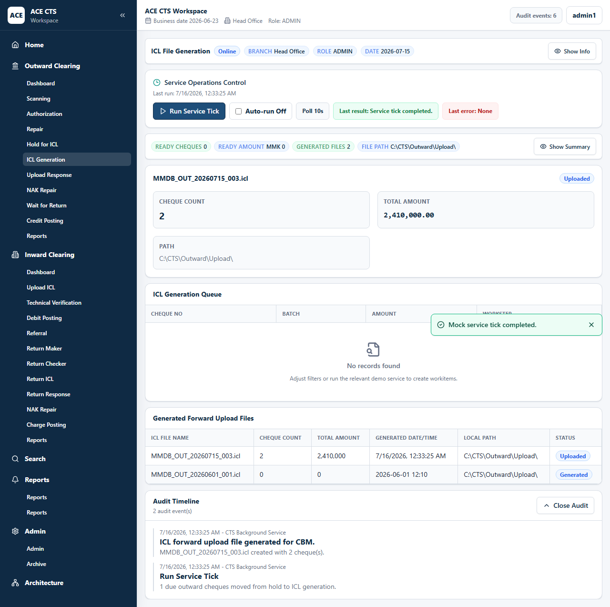

*Figure 24: ACE CTS ICL File Generation (Indicative and subject to change)*

**Priority**  
High

**Integration Touch Point**  
ACE CTS shall exchange ICL files with the Clearing House / CBM. File naming, encryption, signing, and transport specifications shall be finalized with the Bank.

**Functional Requirement**  
ACE CTS shall provide the ICL File Generation / Forward Upload File function as described in this section and shall enforce the applicable workflow, validation, audit, and role controls.

**Actors**  
Service, Admin

**Field Details / Control Behaviour**  
| S. No. | Field Name | Field Type | Control Behaviour | Mandatory | Remarks |
| --- | --- | --- | --- | --- | --- |
| 1 | ICL File Name | Grid | Read-only | No | Generated file |
| 2 | Cheque Count | Number | Read-only | No | Included items |
| 3 | Total Amount | Amount | Read-only | No | File total |
| 4 | Local Path | Text | Read-only | No | Bank-approved output path |

**Options / Buttons**  
| S. No. | Option / Button | Behaviour | Validation / Confirmation | Target Work-step |
| --- | --- | --- | --- | --- |
| 1 | Run Service Tick | Generates file for ready items | Eligible items required | Forward Upload File Response |

**Validation Rules**  
File count and total amount shall reconcile with included instruments.

**Confirmation Messages**  
ACE CTS shall display confirmation messages before committing irreversible or workflow-moving actions where indicated in the options table.

**Target Work-step(s)**  
| Routing Criteria | Target Work-step |
| --- | --- |
| File generated | Forward Upload File Response |

**Audit Trail Requirement**  
Generated file name, count, amount, and path shall be audited.

### 3.4.7 Forward Upload File Response

**Description**  
ACE CTS shall record Clearing House / CBM responses for outward forward upload files at file and per-cheque level.

**Screenshot / Figure**  
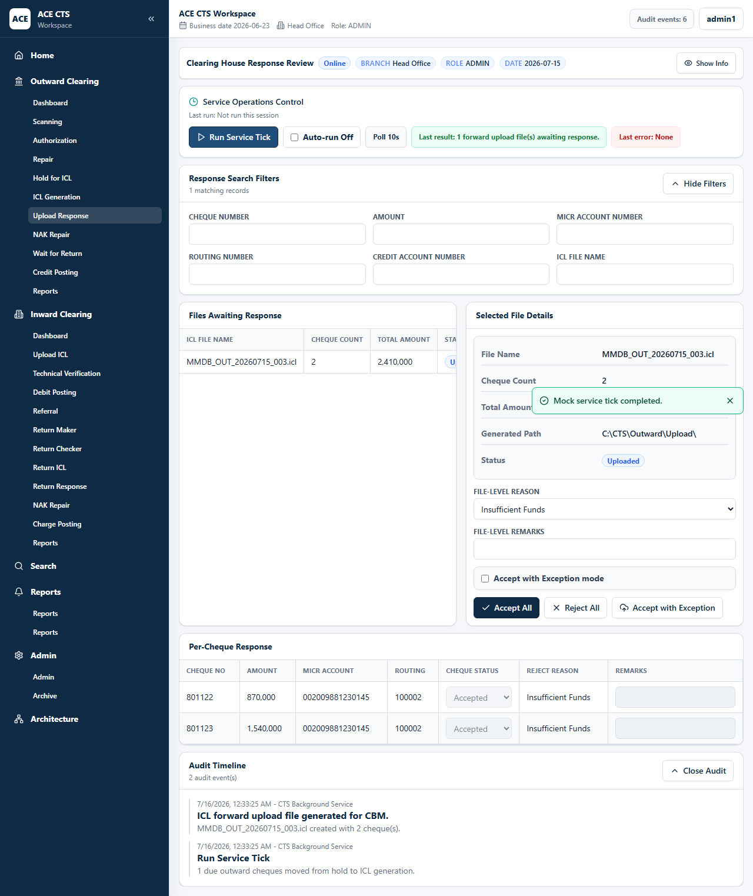

*Figure 25: ACE CTS Forward Upload File Response (Indicative and subject to change)*

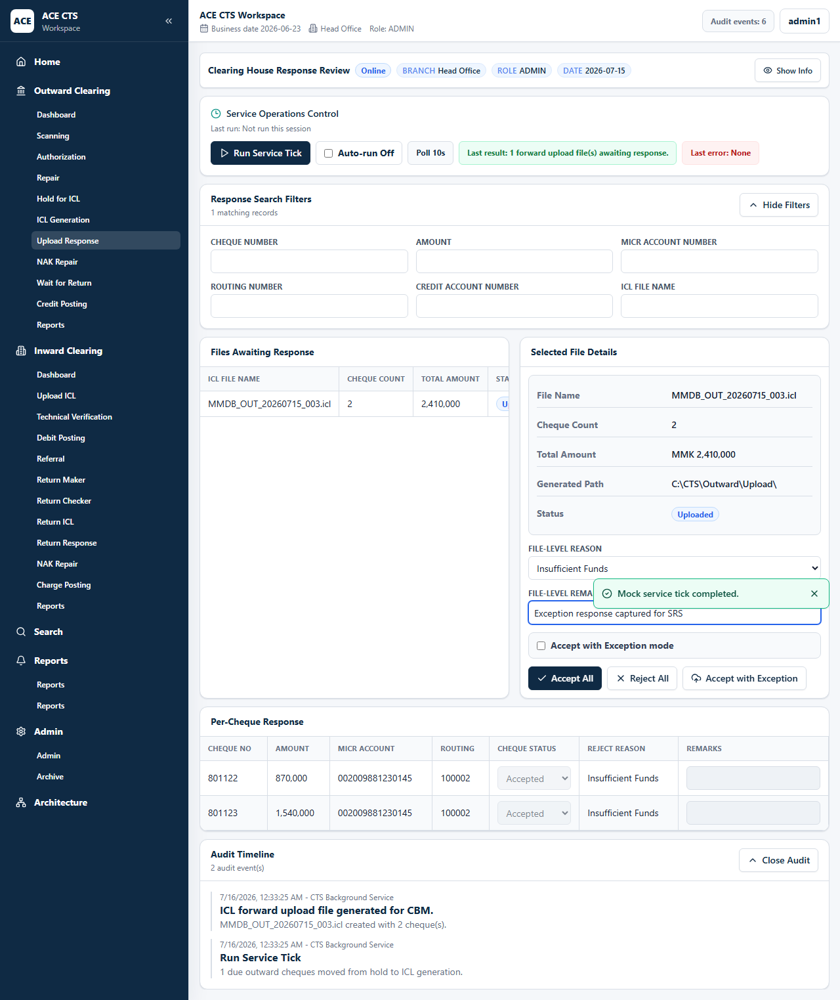

*Figure 26: ACE CTS Forward Upload File Response with Exception (Indicative and subject to change)*

**Priority**  
High

**Integration Touch Point**  
ACE CTS shall receive or record Clearing House / CBM acknowledgement and negative acknowledgement response details.

**Functional Requirement**  
ACE CTS shall provide the Forward Upload File Response function as described in this section and shall enforce the applicable workflow, validation, audit, and role controls.

**Actors**  
Operations user, Admin

**Field Details / Control Behaviour**  
| S. No. | Field Name | Field Type | Control Behaviour | Mandatory | Remarks |
| --- | --- | --- | --- | --- | --- |
| 1 | Search Criteria | Text fields | Editable | No | Cheque, amount, MICR, routing, credit account, file name |
| 2 | Reject Reason | List | Selectable | Conditional | Required for rejected response |
| 3 | File-level Remarks | Text | Editable | Conditional | Required for rejected response |
| 4 | Per-cheque Decision | List | Selectable | Yes | Accepted or Rejected |

**Options / Buttons**  
| S. No. | Option / Button | Behaviour | Validation / Confirmation | Target Work-step |
| --- | --- | --- | --- | --- |
| 1 | Accept All | Marks file cheques accepted | Confirmation through action | Wait for Return |
| 2 | Reject All | Marks file cheques rejected | Reason and remarks required | Outward NAK Repair |
| 3 | Accept with Exception | Accepts file with selected rejected cheques | Rejected items require reason and remarks | Wait for Return / Outward NAK Repair |

**Validation Rules**  
Rejected file or cheque decisions shall require reject reason and remarks.

**Confirmation Messages**  
ACE CTS shall display confirmation messages before committing irreversible or workflow-moving actions where indicated in the options table.

**Target Work-step(s)**  
| Routing Criteria | Target Work-step |
| --- | --- |
| Accepted | Wait for Return |
| Rejected | Outward NAK Repair |
| Accepted with exception | Mixed routing by cheque decision |

**Audit Trail Requirement**  
Response decision, reason, remarks, count, and file reference shall be audited.

### 3.4.8 Outward NAK Repair

**Description**  
ACE CTS shall allow repair of outward items rejected by Clearing House / CBM before regenerating upload files.

**Screenshot / Figure**  
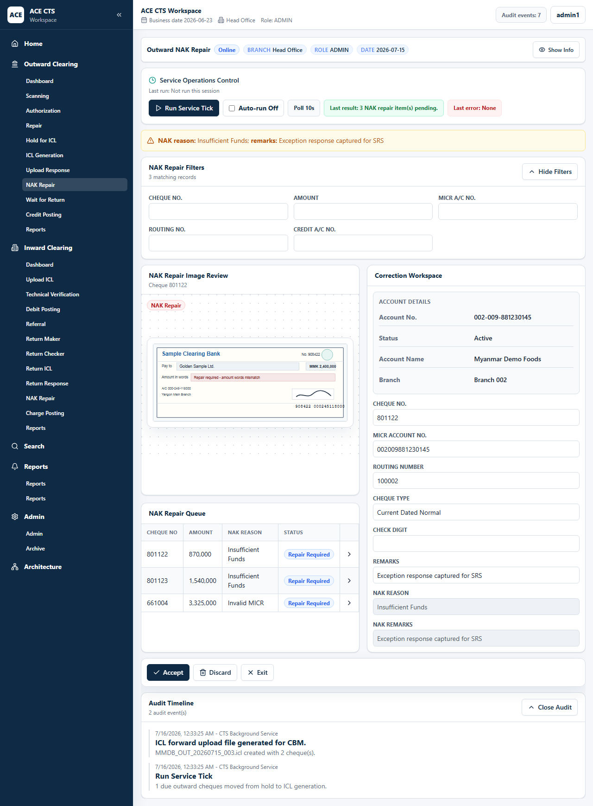

*Figure 27: ACE CTS Outward NAK Repair (Indicative and subject to change)*

**Priority**  
High

**Integration Touch Point**  
ACE CTS shall preserve Clearing House / CBM negative acknowledgement details with the repaired instrument.

**Functional Requirement**  
ACE CTS shall provide the Outward NAK Repair function as described in this section and shall enforce the applicable workflow, validation, audit, and role controls.

**Actors**  
Maker, Admin

**Field Details / Control Behaviour**  
| S. No. | Field Name | Field Type | Control Behaviour | Mandatory | Remarks |
| --- | --- | --- | --- | --- | --- |
| 1 | Search Criteria | Text | Editable | No | Queue filters |
| 2 | Cheque Details | Text | Editable | Yes | Correctable cheque fields |
| 3 | NAK Reason / Remarks | Display | Disabled | No | Response reason and remarks |

**Options / Buttons**  
| S. No. | Option / Button | Behaviour | Validation / Confirmation | Target Work-step |
| --- | --- | --- | --- | --- |
| 1 | Accept | Completes NAK repair | Valid data required | ICL File Generation |
| 2 | Discard | Discards item | Remarks required | Discard |
| 3 | Exit | Leaves page | None | Dashboard |

**Validation Rules**  
Discard from NAK repair shall require remarks.

**Confirmation Messages**  
ACE CTS shall display confirmation messages before committing irreversible or workflow-moving actions where indicated in the options table.

**Target Work-step(s)**  
| Routing Criteria | Target Work-step |
| --- | --- |
| Accepted | ICL File Generation |
| Discarded | Discard |

**Audit Trail Requirement**  
NAK repair accept and discard actions shall be audited.

### 3.4.9 Wait for Return

**Description**  
ACE CTS shall hold CBM-accepted outward cheques while awaiting return download status before cutoff.

**Screenshot / Figure**  
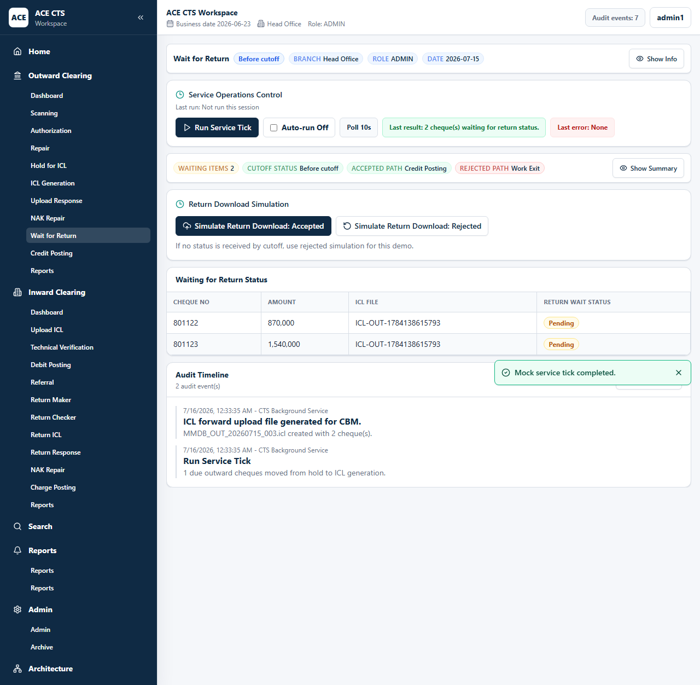

*Figure 28: ACE CTS Wait for Return (Indicative and subject to change)*

**Priority**  
High

**Integration Touch Point**  
ACE CTS shall exchange return status files with Clearing House / CBM.

**Functional Requirement**  
ACE CTS shall provide the Wait for Return function as described in this section and shall enforce the applicable workflow, validation, audit, and role controls.

**Actors**  
Service, Admin

**Field Details / Control Behaviour**  
| S. No. | Field Name | Field Type | Control Behaviour | Mandatory | Remarks |
| --- | --- | --- | --- | --- | --- |
| 1 | Cheque No. | Grid | Read-only | No | Waiting cheque |
| 2 | Amount | Amount | Read-only | No | Cheque amount |
| 3 | ICL File | Text | Read-only | No | Forward file reference |
| 4 | Return Status | Display | Read-only | No | Pending, accepted, or rejected |

**Options / Buttons**  
| S. No. | Option / Button | Behaviour | Validation / Confirmation | Target Work-step |
| --- | --- | --- | --- | --- |
| 1 | Process Return Download | Applies returned status file | Valid response required | Credit Posting / Work Exit |

**Validation Rules**  
ACE CTS shall apply cutoff handling for items without return status according to Bank rules.

**Confirmation Messages**  
ACE CTS shall display confirmation messages before committing irreversible or workflow-moving actions where indicated in the options table.

**Target Work-step(s)**  
| Routing Criteria | Target Work-step |
| --- | --- |
| Return accepted | Credit Posting |
| Return rejected | Work Exit / return handling |

**Audit Trail Requirement**  
Return download result and count shall be audited.

### 3.4.10 Credit Posting

**Description**  
ACE CTS shall generate credit posting files for accepted outward cheques and complete the outward work item.

**Screenshot / Figure**  
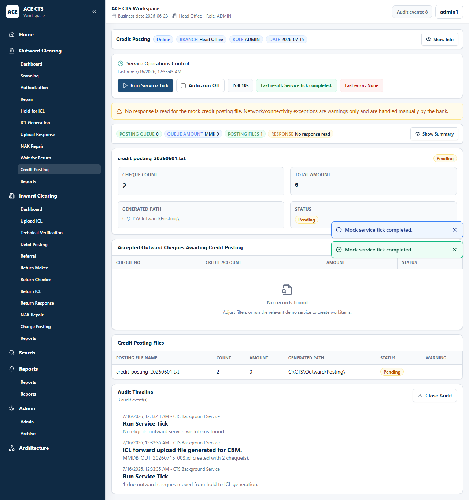

*Figure 29: ACE CTS Credit Posting (Indicative and subject to change)*

**Priority**  
High

**Integration Touch Point**  
ACE CTS shall integrate with CBS for outward credit posting. File format and response handling shall be finalized with the Bank.

**Functional Requirement**  
ACE CTS shall provide the Credit Posting function as described in this section and shall enforce the applicable workflow, validation, audit, and role controls.

**Actors**  
Service, Admin

**Field Details / Control Behaviour**  
| S. No. | Field Name | Field Type | Control Behaviour | Mandatory | Remarks |
| --- | --- | --- | --- | --- | --- |
| 1 | Credit Account | Grid | Read-only | No | Beneficiary account |
| 2 | Amount | Amount | Read-only | No | Posting amount |
| 3 | Posting File Name | Grid | Read-only | No | Generated CBS file |
| 4 | Generated Path | Text | Read-only | No | Bank-approved output path |

**Options / Buttons**  
| S. No. | Option / Button | Behaviour | Validation / Confirmation | Target Work-step |
| --- | --- | --- | --- | --- |
| 1 | Run Service Tick | Generates credit posting file | Eligible accepted items required | Work Exit |

**Validation Rules**  
Posting file count and amount shall reconcile with included instruments.

**Confirmation Messages**  
ACE CTS shall display confirmation messages before committing irreversible or workflow-moving actions where indicated in the options table.

**Target Work-step(s)**  
| Routing Criteria | Target Work-step |
| --- | --- |
| Posting generated | Work Exit |

**Audit Trail Requirement**  
Credit posting file generation shall be audited.

### 3.4.11 Outward Reports

**Description**  
ACE CTS shall provide outward clearing reports with search criteria, output preview, and controlled downloads.

**Screenshot / Figure**  
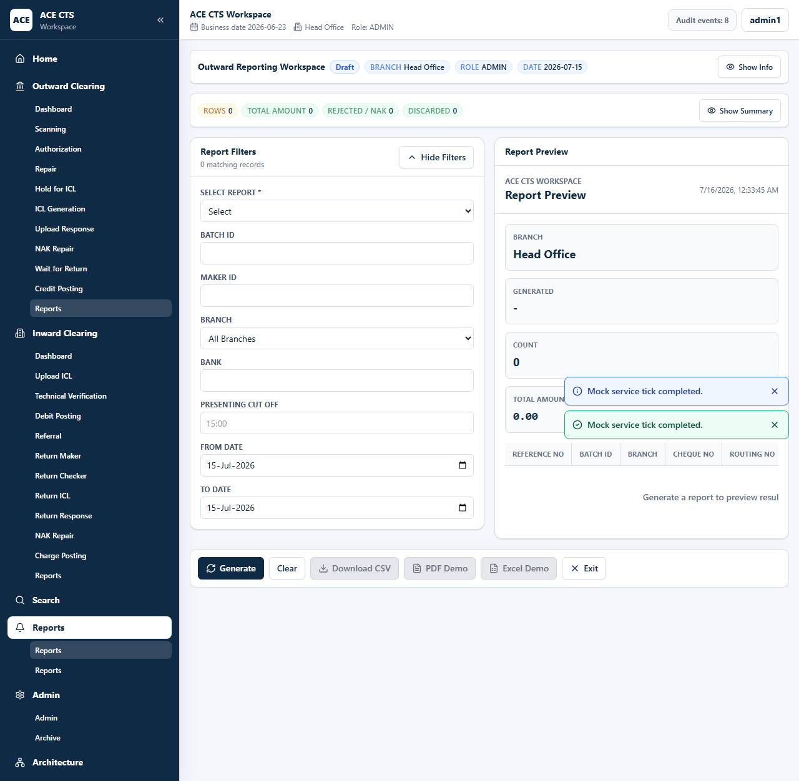

*Figure 30: ACE CTS Outward Reports Search (Indicative and subject to change)*

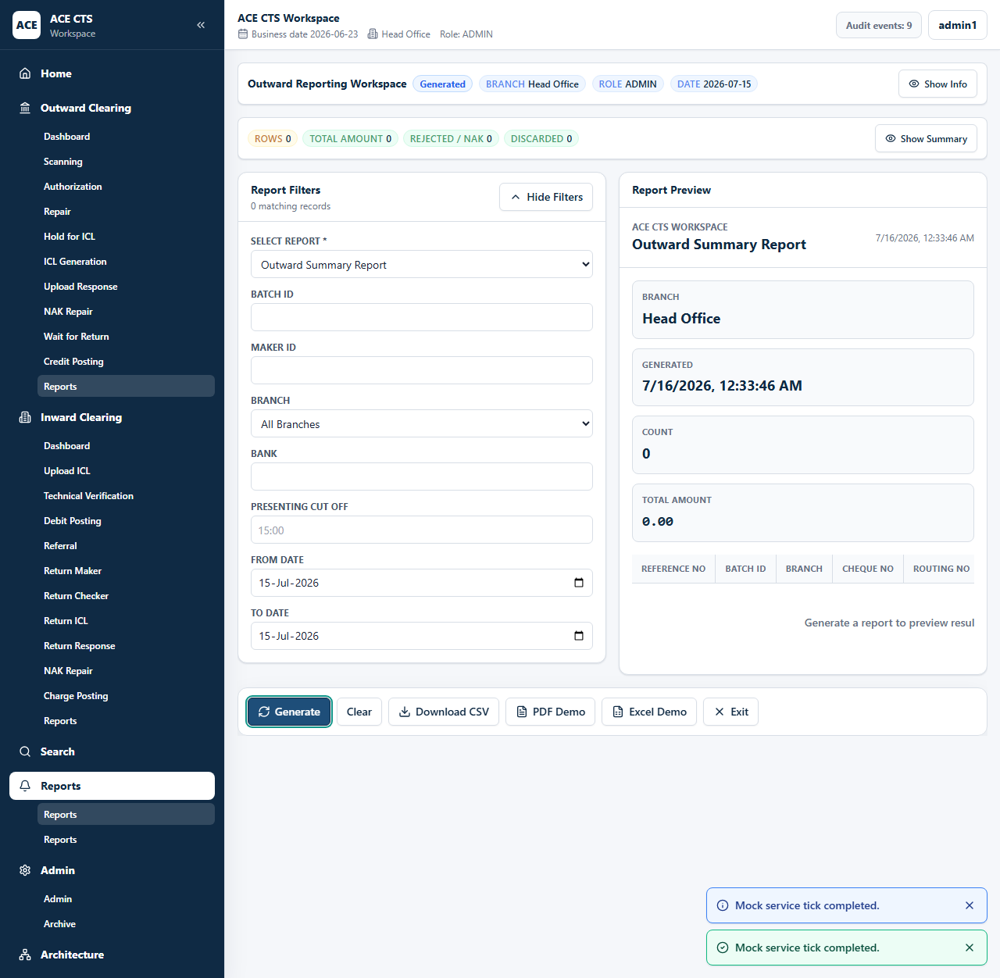

*Figure 31: ACE CTS Outward Report Output (Indicative and subject to change)*

**Priority**  
High

**Integration Touch Point**  
ACE CTS shall provide report extracts in Bank-approved formats.

**Functional Requirement**  
ACE CTS shall provide the Outward Reports function as described in this section and shall enforce the applicable workflow, validation, audit, and role controls.

**Actors**  
Maker, Checker, Admin

**Field Details / Control Behaviour**  
| S. No. | Field Name | Field Type | Control Behaviour | Mandatory | Remarks |
| --- | --- | --- | --- | --- | --- |
| 1 | Select Report | List | Selectable | Yes | Outward report type |
| 2 | Batch ID / Maker ID / Branch / Bank / Cutoff | Search criteria | Editable | No | Filters report output |
| 3 | From Date / To Date | Date | Editable | Yes | Report period |

**Options / Buttons**  
| S. No. | Option / Button | Behaviour | Validation / Confirmation | Target Work-step |
| --- | --- | --- | --- | --- |
| 1 | Generate | Creates report output | Report type required | Report output |
| 2 | Clear | Clears criteria | None | Search |
| 3 | Download / PDF / Excel | Exports generated report | Report must be generated | Download |
| 4 | Exit | Leaves reports | None | Dashboard |

**Validation Rules**  
Report type shall be mandatory. Date criteria shall be applied to returned results.

**Confirmation Messages**  
ACE CTS shall display confirmation messages before committing irreversible or workflow-moving actions where indicated in the options table.

**Target Work-step(s)**  
| Routing Criteria | Target Work-step |
| --- | --- |
| Generate | Report output |

**Audit Trail Requirement**  
Report generation and download shall be audited.

#### 3.4.11.1 Outward Summary Report
ACE CTS shall provide the Outward Summary Report with applicable search criteria, generated output, export control, and audit trail.

#### 3.4.11.2 Outward Return Report
ACE CTS shall provide the Outward Return Report with applicable search criteria, generated output, export control, and audit trail.

#### 3.4.11.3 Negative Acknowledgement Report
ACE CTS shall provide the Negative Acknowledgement Report with applicable search criteria, generated output, export control, and audit trail.

#### 3.4.11.4 Outward Discard Cheques Report
ACE CTS shall provide the Outward Discard Cheques Report with applicable search criteria, generated output, export control, and audit trail.

#### 3.4.11.5 Cheque Introduced in the System
ACE CTS shall provide the Cheque Introduced in the System with applicable search criteria, generated output, export control, and audit trail.

#### 3.4.11.6 Outward Cheque Honored
ACE CTS shall provide the Outward Cheque Honored with applicable search criteria, generated output, export control, and audit trail.

#### 3.4.11.7 CB Accepted Cheques
ACE CTS shall provide the CB Accepted Cheques with applicable search criteria, generated output, export control, and audit trail.

#### 3.4.11.8 Return Advice Generation
ACE CTS shall provide the Return Advice Generation with applicable search criteria, generated output, export control, and audit trail.

### 3.5 Inward Process
### 3.5.1 Inward Dashboard & Menu

**Description**  
ACE CTS shall display inward queue counts, process navigation, workflow tiles, charts, and recent workitems.

**Screenshot / Figure**  

*Figure 32: ACE CTS Inward Process Flow (Indicative and subject to change)*

**Priority**  
High

**Integration Touch Point**  
ACE CTS shall present operational inward queue data from the application database.

**Functional Requirement**  
ACE CTS shall provide the Inward Dashboard & Menu function as described in this section and shall enforce the applicable workflow, validation, audit, and role controls.

**Actors**  
Maker, Checker, Admin

**Field Details / Control Behaviour**  
| S. No. | Field Name | Field Type | Control Behaviour | Mandatory | Remarks |
| --- | --- | --- | --- | --- | --- |
| 1 | Workflow Tiles | Display/action | Selectable | No | Queue counts |
| 2 | Recent Workitems | Grid | Read-only | No | Inward items |
| 3 | Workitems Chart | Chart | Read-only | No | Queue distribution |

**Options / Buttons**  
| S. No. | Option / Button | Behaviour | Validation / Confirmation | Target Work-step |
| --- | --- | --- | --- | --- |
| 1 | Workflow Tile | Opens selected inward work-step | Role access applies | Selected queue |

**Validation Rules**  
Counts shall update when inward items move between work-steps.

**Confirmation Messages**  
ACE CTS shall display confirmation messages before committing irreversible or workflow-moving actions where indicated in the options table.

**Target Work-step(s)**  
| Routing Criteria | Target Work-step |
| --- | --- |
| Tile selected | Selected inward work-step |

**Audit Trail Requirement**  
Dashboard access may be logged according to Bank audit policy.

### 3.5.2 Read and Upload ICL File / Forward Download File

**Description**  
ACE CTS shall import inward forward download ICL files received from Clearing House / CBM and route instruments to technical verification.

**Screenshot / Figure**  
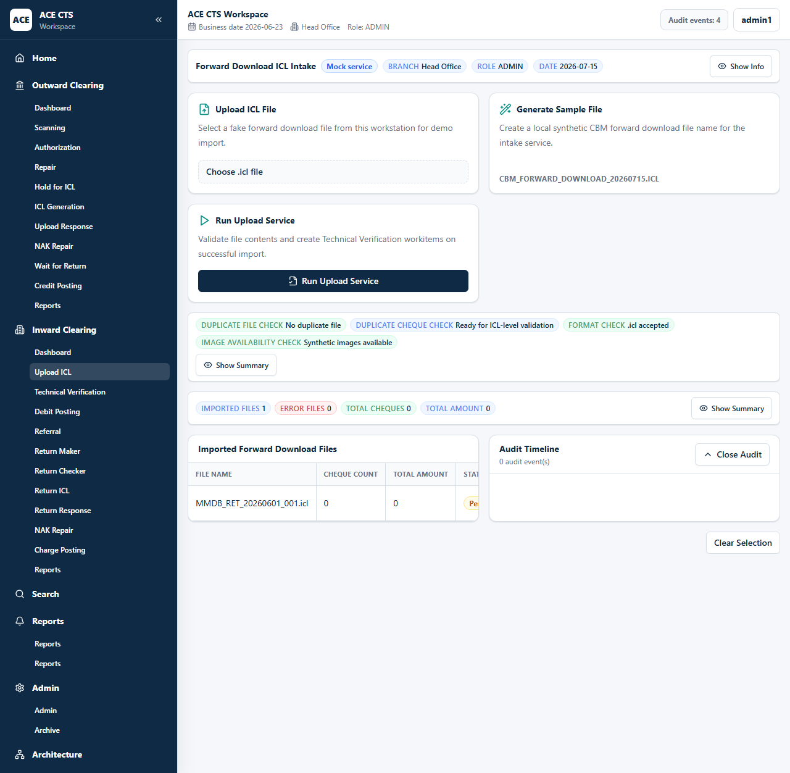

*Figure 33: ACE CTS Read and Upload ICL File (Indicative and subject to change)*

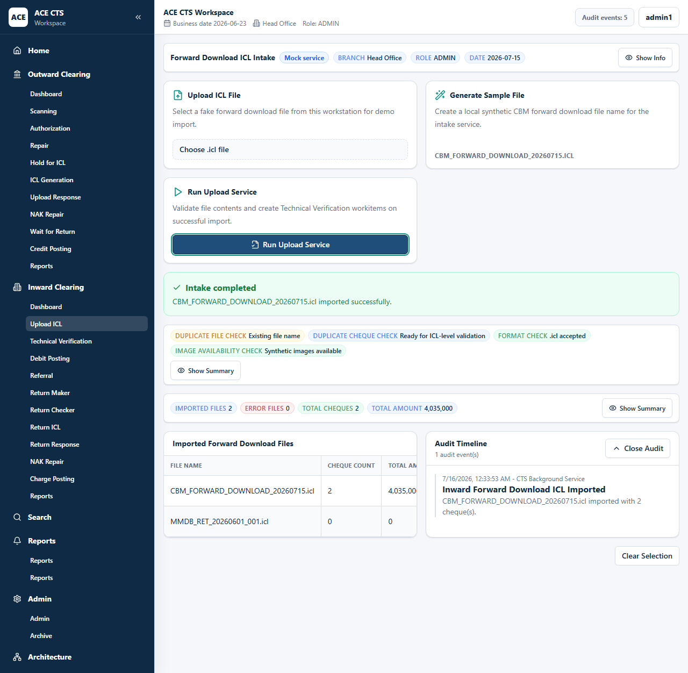

*Figure 34: ACE CTS Uploaded Forward Download File (Indicative and subject to change)*

**Priority**  
High

**Integration Touch Point**  
ACE CTS shall exchange ICL files with Clearing House / CBM. Final interface specifications shall be finalized with the Bank.

**Functional Requirement**  
ACE CTS shall provide the Read and Upload ICL File / Forward Download File function as described in this section and shall enforce the applicable workflow, validation, audit, and role controls.

**Actors**  
Maker, Service, Admin

**Field Details / Control Behaviour**  
| S. No. | Field Name | Field Type | Control Behaviour | Mandatory | Remarks |
| --- | --- | --- | --- | --- | --- |
| 1 | Forward Download File | File input | Selectable | Yes | ICL input file |
| 2 | Imported File Details | Grid | Read-only | No | File name, count, amount, status, error file |

**Options / Buttons**  
| S. No. | Option / Button | Behaviour | Validation / Confirmation | Target Work-step |
| --- | --- | --- | --- | --- |
| 1 | Generate Sample Forward Download File | Stages file name for upload | None | Upload ICL |
| 2 | Run Upload Service | Imports file | File validation and duplicate checks | Technical Verification |

**Validation Rules**  
ACE CTS shall validate file format, duplicate file reference, and duplicate cheque information.

**Confirmation Messages**  
ACE CTS shall display confirmation messages before committing irreversible or workflow-moving actions where indicated in the options table.

**Target Work-step(s)**  
| Routing Criteria | Target Work-step |
| --- | --- |
| Valid file | Technical Verification |
| Invalid or duplicate file | Error handling queue / audit |

**Audit Trail Requirement**  
ICL import success and failure shall be audited.

### 3.5.3 Technical Verification

**Description**  
ACE CTS shall provide inward technical verification with cheque image, signature image, CBS account details, reject reason, and remarks.

**Screenshot / Figure**  
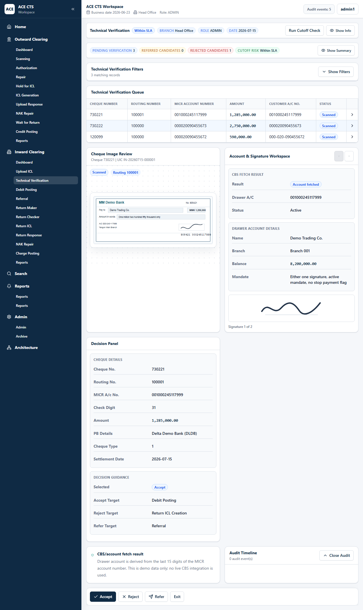

*Figure 35: ACE CTS Technical Verification Search (Indicative and subject to change)*

*Figure 36: ACE CTS Technical Verification Detail (Indicative and subject to change)*

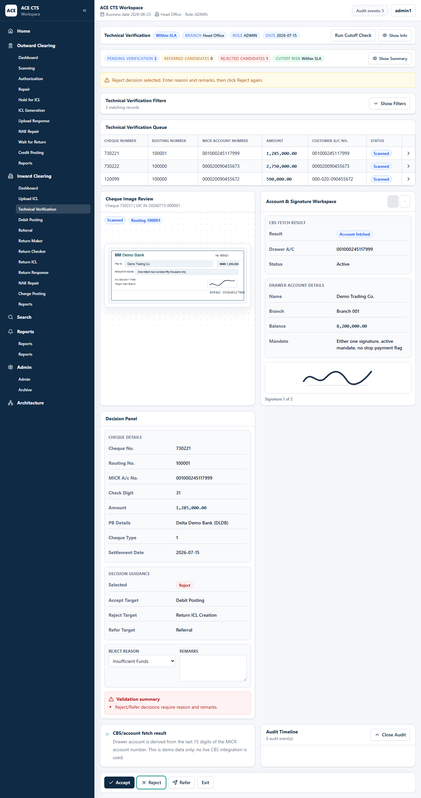

*Figure 37: ACE CTS Technical Verification Reject Window (Indicative and subject to change)*

**Priority**  
High

**Integration Touch Point**  
ACE CTS shall integrate with CBS for account, balance, status, stop payment, and signature details.

**Functional Requirement**  
ACE CTS shall provide the Technical Verification function as described in this section and shall enforce the applicable workflow, validation, audit, and role controls.

**Actors**  
Maker, Admin

**Field Details / Control Behaviour**  
| S. No. | Field Name | Field Type | Control Behaviour | Mandatory | Remarks |
| --- | --- | --- | --- | --- | --- |
| 1 | Search Criteria | Text | Editable | No | Cheque, amount, MICR, routing, customer account |
| 2 | Account Details | Display | Disabled | No | Drawer account and balance |
| 3 | Cheque Details | Display | Disabled | No | Cheque and settlement details |
| 4 | Reject Reason / Remarks | List/text | Editable | Conditional | Required for Reject or Refer |

**Options / Buttons**  
| S. No. | Option / Button | Behaviour | Validation / Confirmation | Target Work-step |
| --- | --- | --- | --- | --- |
| 1 | Accept | Accepts cheque | Confirmation required | Debit Posting |
| 2 | Reject | Rejects cheque | Reason and remarks required | Return ICL Creation |
| 3 | Refer | Refers cheque to checker | Reason and remarks required | Referral |
| 4 | Run Cutoff Check | Applies cutoff auto-return rule | Cutoff time applies | Return ICL Creation |

**Validation Rules**  
Reject and refer shall require reason and remarks. PO handling may hide sensitive balance and signature details where applicable.

**Confirmation Messages**  
ACE CTS shall display confirmation messages before committing irreversible or workflow-moving actions where indicated in the options table.

**Target Work-step(s)**  
| Routing Criteria | Target Work-step |
| --- | --- |
| Accept | Debit Posting |
| Reject | Return ICL Creation |
| Refer | Referral |

**Audit Trail Requirement**  
Technical accept, reject, refer, and cutoff actions shall be audited.

### 3.5.4 Debit Posting

**Description**  
ACE CTS shall generate debit posting files for accepted inward cheques.

**Screenshot / Figure**  
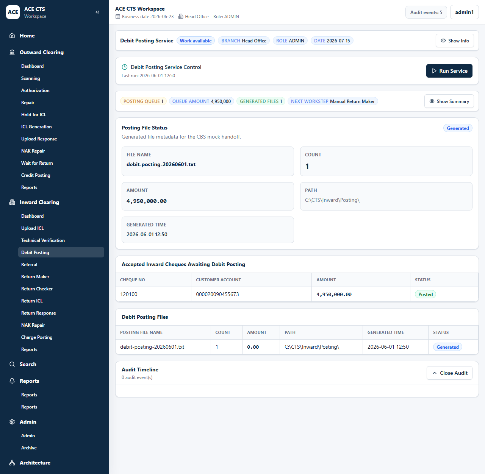

*Figure 38: ACE CTS Debit Posting (Indicative and subject to change)*

**Priority**  
High

**Integration Touch Point**  
ACE CTS shall integrate with CBS for debit posting. Interface specifications shall be finalized with the Bank.

**Functional Requirement**  
ACE CTS shall provide the Debit Posting function as described in this section and shall enforce the applicable workflow, validation, audit, and role controls.

**Actors**  
Service, Admin

**Field Details / Control Behaviour**  
| S. No. | Field Name | Field Type | Control Behaviour | Mandatory | Remarks |
| --- | --- | --- | --- | --- | --- |
| 1 | Customer Account | Grid | Read-only | No | Account to debit |
| 2 | Amount | Amount | Read-only | No | Debit amount |
| 3 | Posting File Name / Count / Amount / Path | Grid | Read-only | No | Generated posting file details |

**Options / Buttons**  
| S. No. | Option / Button | Behaviour | Validation / Confirmation | Target Work-step |
| --- | --- | --- | --- | --- |
| 1 | Run Debit Posting Service | Generates debit posting file | Eligible items required | Manual Return Maker |

**Validation Rules**  
Posting file count and amount shall reconcile with accepted inward cheques.

**Confirmation Messages**  
ACE CTS shall display confirmation messages before committing irreversible or workflow-moving actions where indicated in the options table.

**Target Work-step(s)**  
| Routing Criteria | Target Work-step |
| --- | --- |
| Posted | Manual Return Maker |

**Audit Trail Requirement**  
Debit posting file generation and item inclusion shall be audited.

### 3.5.5 Referral

**Description**  
ACE CTS shall allow branch/checker referral review of inward items with account/signature details.

**Screenshot / Figure**  
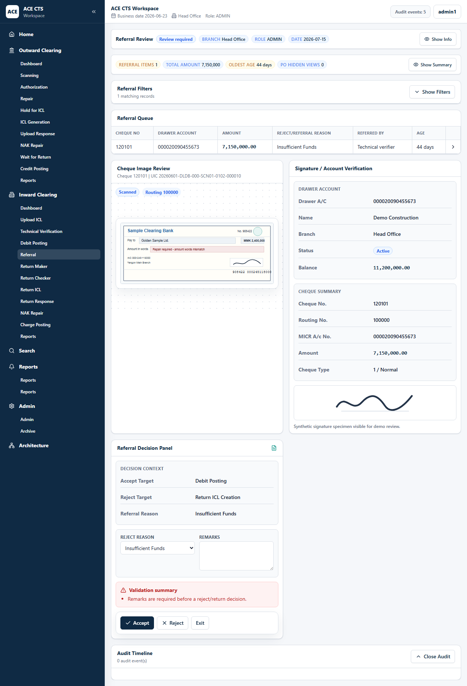

*Figure 39: ACE CTS Referral Search (Indicative and subject to change)*

*Figure 40: ACE CTS Referral Detail (Indicative and subject to change)*

**Priority**  
High

**Integration Touch Point**  
ACE CTS shall retrieve account and signature data from CBS or the Bank signature source.

**Functional Requirement**  
ACE CTS shall provide the Referral function as described in this section and shall enforce the applicable workflow, validation, audit, and role controls.

**Actors**  
Checker, Admin

**Field Details / Control Behaviour**  
| S. No. | Field Name | Field Type | Control Behaviour | Mandatory | Remarks |
| --- | --- | --- | --- | --- | --- |
| 1 | Search Criteria | Text | Editable | No | Queue filters |
| 2 | Account Details | Display | Disabled | No | Drawer account data |
| 3 | Reject Reason / Remarks | List/text | Editable | Conditional | Required for reject |

**Options / Buttons**  
| S. No. | Option / Button | Behaviour | Validation / Confirmation | Target Work-step |
| --- | --- | --- | --- | --- |
| 1 | Accept | Accepts referred cheque | Confirmation required | Debit Posting |
| 2 | Reject | Rejects referred cheque | Reason and remarks required | Return ICL Creation |
| 3 | Exit | Leaves page | None | Dashboard |

**Validation Rules**  
Referral reject shall require reason and remarks.

**Confirmation Messages**  
ACE CTS shall display confirmation messages before committing irreversible or workflow-moving actions where indicated in the options table.

**Target Work-step(s)**  
| Routing Criteria | Target Work-step |
| --- | --- |
| Accept | Debit Posting |
| Reject | Return ICL Creation |

**Audit Trail Requirement**  
Referral accept and reject shall be audited.

### 3.5.6 Manual Cheque Return - Maker

**Description**  
ACE CTS shall allow a maker to manually return an accepted inward cheque before cutoff.

**Screenshot / Figure**  

*Figure 41: ACE CTS Manual Return Maker Search (Indicative and subject to change)*

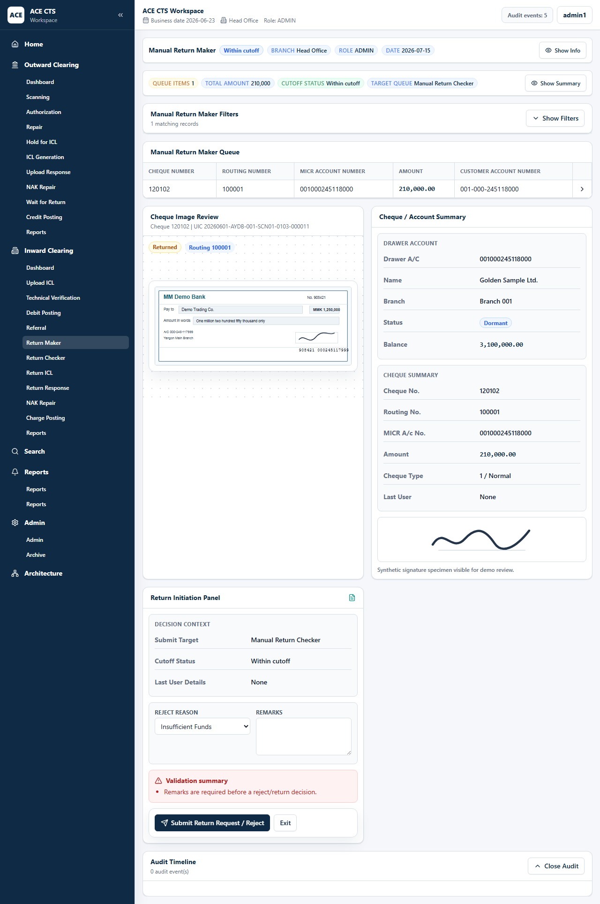

*Figure 42: ACE CTS Manual Return Maker Detail (Indicative and subject to change)*

**Priority**  
High

**Integration Touch Point**  
ACE CTS shall apply cutoff and Bank return reason configuration.

**Functional Requirement**  
ACE CTS shall provide the Manual Cheque Return - Maker function as described in this section and shall enforce the applicable workflow, validation, audit, and role controls.

**Actors**  
Maker, Admin

**Field Details / Control Behaviour**  
| S. No. | Field Name | Field Type | Control Behaviour | Mandatory | Remarks |
| --- | --- | --- | --- | --- | --- |
| 1 | Search Criteria | Text | Editable | No | Queue filters |
| 2 | Reject Reason | List | Selectable | Yes | Return reason |
| 3 | Remarks | Text | Editable | Yes | Maker remarks |

**Options / Buttons**  
| S. No. | Option / Button | Behaviour | Validation / Confirmation | Target Work-step |
| --- | --- | --- | --- | --- |
| 1 | Reject | Submits maker return decision | Reason and remarks required | Manual Return Checker |
| 2 | Exit | Leaves page | None | Dashboard |

**Validation Rules**  
Manual return maker decision shall require reason and remarks.

**Confirmation Messages**  
ACE CTS shall display confirmation messages before committing irreversible or workflow-moving actions where indicated in the options table.

**Target Work-step(s)**  
| Routing Criteria | Target Work-step |
| --- | --- |
| Reject | Manual Return Checker |

**Audit Trail Requirement**  
Maker return decision shall be audited.

### 3.5.7 Manual Cheque Return - Checker

**Description**  
ACE CTS shall allow checker approval or rejection of manual return maker decisions.

**Screenshot / Figure**  
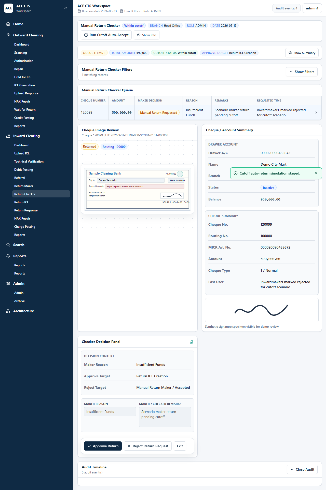

*Figure 43: ACE CTS Manual Return Checker Search (Indicative and subject to change)*

*Figure 44: ACE CTS Manual Return Checker Detail (Indicative and subject to change)*

**Priority**  
High

**Integration Touch Point**  
ACE CTS shall apply Bank maker-checker and cutoff policy.

**Functional Requirement**  
ACE CTS shall provide the Manual Cheque Return - Checker function as described in this section and shall enforce the applicable workflow, validation, audit, and role controls.

**Actors**  
Checker, Admin

**Field Details / Control Behaviour**  
| S. No. | Field Name | Field Type | Control Behaviour | Mandatory | Remarks |
| --- | --- | --- | --- | --- | --- |
| 1 | Search Criteria | Text | Editable | No | Queue filters |
| 2 | Last User Details | Display | Disabled | No | Maker decision details |
| 3 | Reject Reason / Remarks | Display/edit | Read-only or editable | Conditional | Return decision information |

**Options / Buttons**  
| S. No. | Option / Button | Behaviour | Validation / Confirmation | Target Work-step |
| --- | --- | --- | --- | --- |
| 1 | Accept | Accepts maker return decision | Maker-checker rule applies | Return ICL Creation |
| 2 | Reject | Rejects maker return decision | Maker-checker rule applies | Manual Return Maker |
| 3 | Run Cutoff Auto-Accept | Auto-accepts pending maker decisions after cutoff | Cutoff rule applies | Return ICL Creation |

**Validation Rules**  
The same user shall not check his or her own manual return decision unless Bank policy defines an administrator override.

**Confirmation Messages**  
ACE CTS shall display confirmation messages before committing irreversible or workflow-moving actions where indicated in the options table.

**Target Work-step(s)**  
| Routing Criteria | Target Work-step |
| --- | --- |
| Accept | Return ICL Creation |
| Reject | Manual Return Maker |

**Audit Trail Requirement**  
Manual return checker decision shall be audited.

### 3.5.8 ICL Return Upload File Creation

**Description**  
ACE CTS shall generate inward return upload ICL files for Pay/No Pay instruments.

**Screenshot / Figure**  
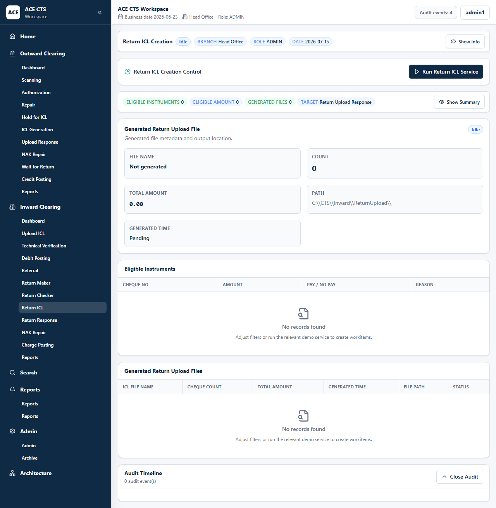

*Figure 45: ACE CTS ICL Return Upload File Creation (Indicative and subject to change)*

**Priority**  
High

**Integration Touch Point**  
ACE CTS shall exchange return ICL files with Clearing House / CBM.

**Functional Requirement**  
ACE CTS shall provide the ICL Return Upload File Creation function as described in this section and shall enforce the applicable workflow, validation, audit, and role controls.

**Actors**  
Service, Admin

**Field Details / Control Behaviour**  
| S. No. | Field Name | Field Type | Control Behaviour | Mandatory | Remarks |
| --- | --- | --- | --- | --- | --- |
| 1 | Ready Instruments | Grid | Read-only | No | Cheque, amount, pay/no pay, reason |
| 2 | Generated Return Upload Files | Grid | Read-only | No | File name, count, amount, time, path |

**Options / Buttons**  
| S. No. | Option / Button | Behaviour | Validation / Confirmation | Target Work-step |
| --- | --- | --- | --- | --- |
| 1 | Run Return ICL Service | Generates return upload file | Eligible return items required | Return Upload File Response |

**Validation Rules**  
Return file count and amount shall reconcile with included instruments.

**Confirmation Messages**  
ACE CTS shall display confirmation messages before committing irreversible or workflow-moving actions where indicated in the options table.

**Target Work-step(s)**  
| Routing Criteria | Target Work-step |
| --- | --- |
| File generated | Return Upload File Response |

**Audit Trail Requirement**  
Return upload file generation shall be audited.

### 3.5.9 Return Upload File Response

**Description**  
ACE CTS shall capture Clearing House / CBM response for inward return upload files.

**Screenshot / Figure**  
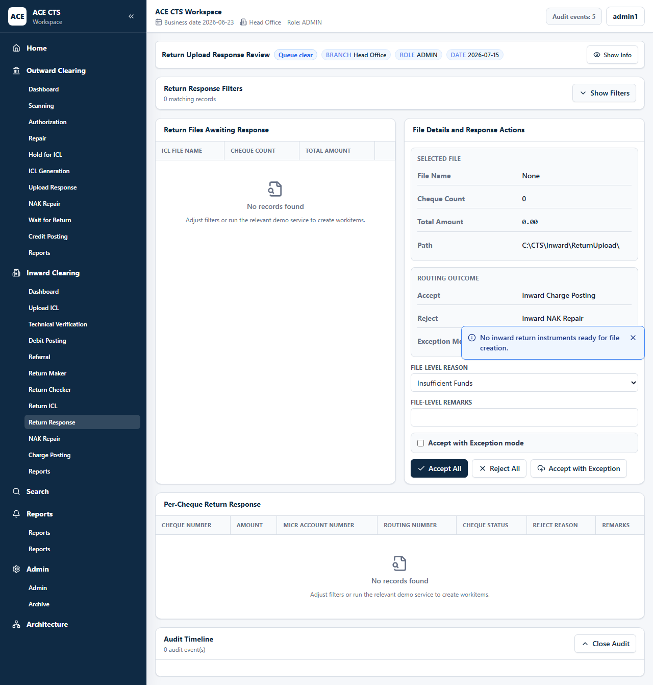

*Figure 46: ACE CTS Return Upload File Response (Indicative and subject to change)*

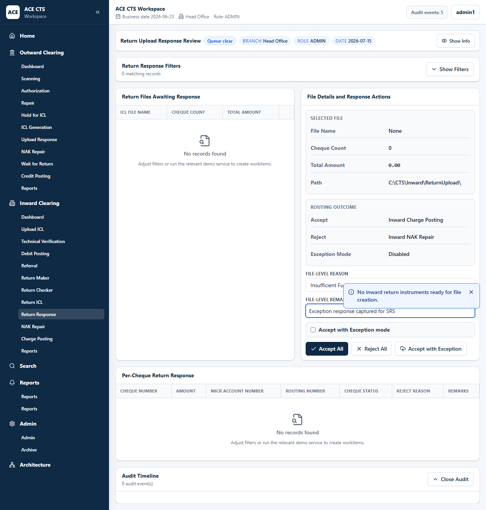

*Figure 47: ACE CTS Return Upload File Response with Exception (Indicative and subject to change)*

**Priority**  
High

**Integration Touch Point**  
ACE CTS shall receive or record Clearing House / CBM return upload acknowledgement details.

**Functional Requirement**  
ACE CTS shall provide the Return Upload File Response function as described in this section and shall enforce the applicable workflow, validation, audit, and role controls.

**Actors**  
Operations user, Admin

**Field Details / Control Behaviour**  
| S. No. | Field Name | Field Type | Control Behaviour | Mandatory | Remarks |
| --- | --- | --- | --- | --- | --- |
| 1 | Search Criteria | Text | Editable | No | Cheque, amount, MICR, routing, account, file |
| 2 | Reject Reason | List | Selectable | Conditional | Required for rejected response |
| 3 | File-level Remarks | Text | Editable | Conditional | Required for rejected response |
| 4 | Per-cheque Decision | List | Selectable | Yes | Accepted or rejected |

**Options / Buttons**  
| S. No. | Option / Button | Behaviour | Validation / Confirmation | Target Work-step |
| --- | --- | --- | --- | --- |
| 1 | Accept All | Accepts return upload response | Confirmation through action | Charge Posting / Work Exit |
| 2 | Reject All | Rejects file response | Reason and remarks required | Inward NAK Repair |
| 3 | Accept with Exception | Routes per-cheque exceptions | Rejected items require reason and remarks | Mixed routing |

**Validation Rules**  
Rejected response decisions shall require reason and remarks.

**Confirmation Messages**  
ACE CTS shall display confirmation messages before committing irreversible or workflow-moving actions where indicated in the options table.

**Target Work-step(s)**  
| Routing Criteria | Target Work-step |
| --- | --- |
| Accepted | Inward Charge Posting or Work Exit |
| Rejected | Inward NAK Repair |

**Audit Trail Requirement**  
Return response decisions shall be audited.

### 3.5.10 Inward NAK Repair

**Description**  
ACE CTS shall allow repair of inward return upload items rejected by Clearing House / CBM.

**Screenshot / Figure**  
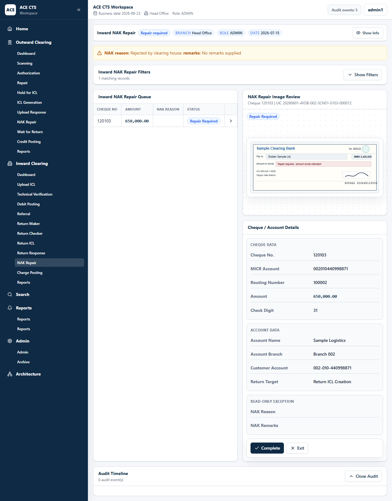

*Figure 48: ACE CTS Inward NAK Repair (Indicative and subject to change)*

**Priority**  
High

**Integration Touch Point**  
ACE CTS shall retain Clearing House / CBM NAK details with the item.

**Functional Requirement**  
ACE CTS shall provide the Inward NAK Repair function as described in this section and shall enforce the applicable workflow, validation, audit, and role controls.

**Actors**  
Maker, Admin

**Field Details / Control Behaviour**  
| S. No. | Field Name | Field Type | Control Behaviour | Mandatory | Remarks |
| --- | --- | --- | --- | --- | --- |
| 1 | Search Criteria | Text | Editable | No | Queue filters |
| 2 | Cheque / Account Data | Display | Disabled | No | Cheque and NAK details |

**Options / Buttons**  
| S. No. | Option / Button | Behaviour | Validation / Confirmation | Target Work-step |
| --- | --- | --- | --- | --- |
| 1 | Complete | Completes repair | Valid data required | Return ICL Creation |
| 2 | Exit | Leaves page | None | Dashboard |

**Validation Rules**  
Only inward NAK repair queue items shall be available on this page.

**Confirmation Messages**  
ACE CTS shall display confirmation messages before committing irreversible or workflow-moving actions where indicated in the options table.

**Target Work-step(s)**  
| Routing Criteria | Target Work-step |
| --- | --- |
| Complete | Return ICL Creation |

**Audit Trail Requirement**  
Inward NAK repair completion shall be audited.

### 3.5.11 Inward Charge Posting

**Description**  
ACE CTS shall generate charge posting files for inward items that require charge posting.

**Screenshot / Figure**  
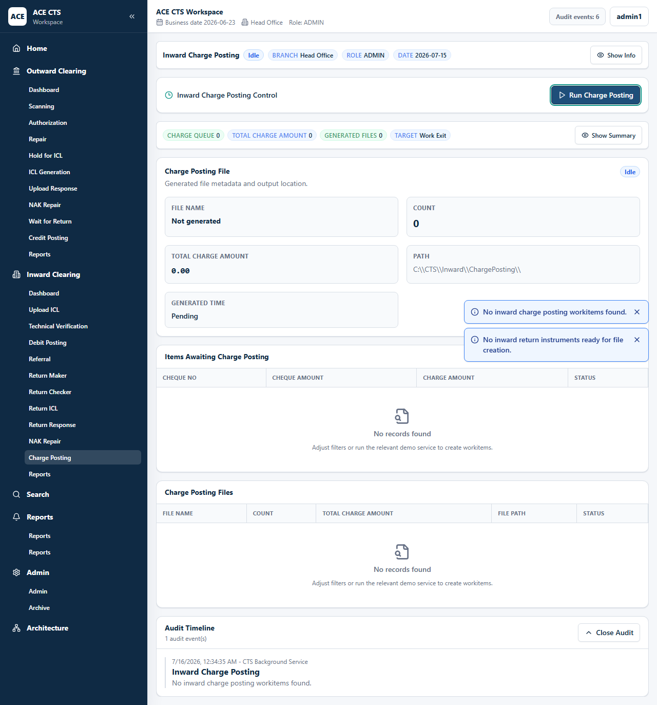

*Figure 49: ACE CTS Inward Charge Posting (Indicative and subject to change)*

**Priority**  
High

**Integration Touch Point**  
ACE CTS shall integrate with CBS for charge posting.

**Functional Requirement**  
ACE CTS shall provide the Inward Charge Posting function as described in this section and shall enforce the applicable workflow, validation, audit, and role controls.

**Actors**  
Service, Admin

**Field Details / Control Behaviour**  
| S. No. | Field Name | Field Type | Control Behaviour | Mandatory | Remarks |
| --- | --- | --- | --- | --- | --- |
| 1 | Charge Amount | Amount | Read-only | No | Configured charge |
| 2 | Charge Posting Files | Grid | Read-only | No | File, count, total charge amount, path, status |

**Options / Buttons**  
| S. No. | Option / Button | Behaviour | Validation / Confirmation | Target Work-step |
| --- | --- | --- | --- | --- |
| 1 | Run Charge Posting | Generates charge posting file | Eligible charge items required | Work Exit |

**Validation Rules**  
Charge count and total amount shall reconcile with included items and configured charge amount.

**Confirmation Messages**  
ACE CTS shall display confirmation messages before committing irreversible or workflow-moving actions where indicated in the options table.

**Target Work-step(s)**  
| Routing Criteria | Target Work-step |
| --- | --- |
| Posting generated | Work Exit |

**Audit Trail Requirement**  
Charge posting generation shall be audited.

### 3.5.12 Inward Reports

**Description**  
ACE CTS shall provide inward clearing reports with search criteria, output preview, and controlled downloads.

**Screenshot / Figure**  
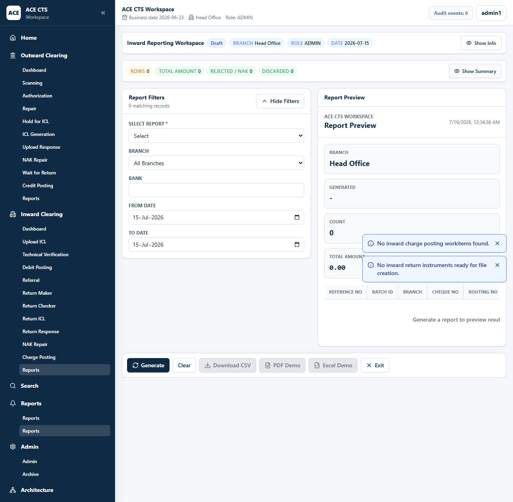

*Figure 50: ACE CTS Inward Reports Search (Indicative and subject to change)*

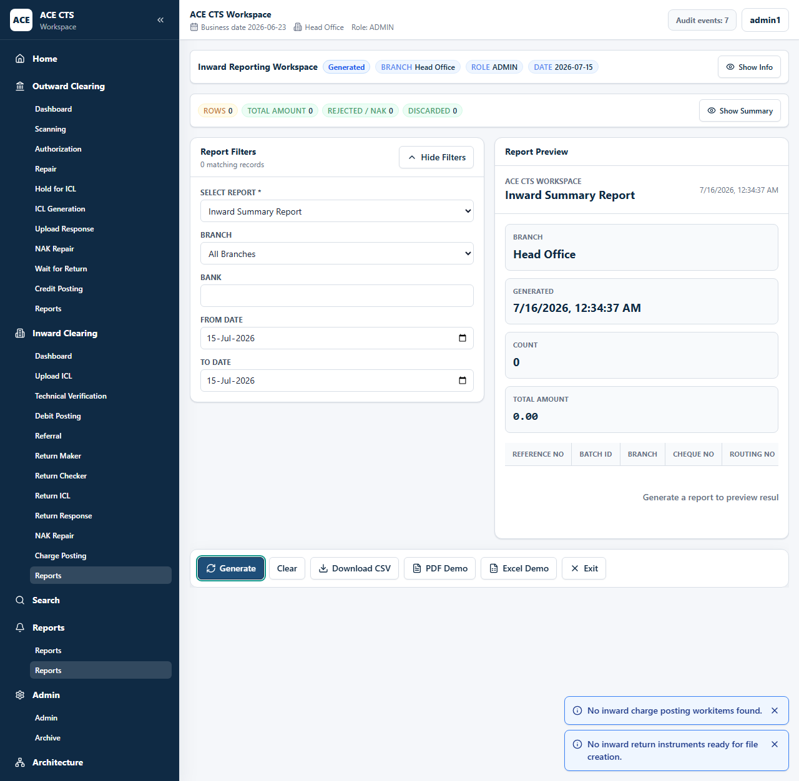

*Figure 51: ACE CTS Inward Report Output (Indicative and subject to change)*

**Priority**  
High

**Integration Touch Point**  
ACE CTS shall provide inward report extracts in Bank-approved formats.

**Functional Requirement**  
ACE CTS shall provide the Inward Reports function as described in this section and shall enforce the applicable workflow, validation, audit, and role controls.

**Actors**  
Maker, Checker, Admin

**Field Details / Control Behaviour**  
| S. No. | Field Name | Field Type | Control Behaviour | Mandatory | Remarks |
| --- | --- | --- | --- | --- | --- |
| 1 | Select Report | List | Selectable | Yes | Inward report type |
| 2 | Branch / Bank / Date Range | Search criteria | Editable | No | Filters report output |

**Options / Buttons**  
| S. No. | Option / Button | Behaviour | Validation / Confirmation | Target Work-step |
| --- | --- | --- | --- | --- |
| 1 | Generate | Creates report output | Report type required | Report output |
| 2 | Clear | Clears criteria | None | Search |
| 3 | Download / PDF / Excel | Exports generated report | Report must be generated | Download |
| 4 | Exit | Leaves reports | None | Dashboard |

**Validation Rules**  
Report type shall be mandatory. Date criteria shall be applied to returned results.

**Confirmation Messages**  
ACE CTS shall display confirmation messages before committing irreversible or workflow-moving actions where indicated in the options table.

**Target Work-step(s)**  
| Routing Criteria | Target Work-step |
| --- | --- |
| Generate | Report output |

**Audit Trail Requirement**  
Report generation and download shall be audited.

#### 3.5.12.1 Inward Introduction Report
ACE CTS shall provide the Inward Introduction Report with applicable search criteria, generated output, export control, and audit trail.

#### 3.5.12.2 Inward Summary Report
ACE CTS shall provide the Inward Summary Report with applicable search criteria, generated output, export control, and audit trail.

#### 3.5.12.3 Inward Clearing Report Referral
ACE CTS shall provide the Inward Clearing Report Referral with applicable search criteria, generated output, export control, and audit trail.

#### 3.5.12.4 Inward Clearing Report
ACE CTS shall provide the Inward Clearing Report with applicable search criteria, generated output, export control, and audit trail.

#### 3.5.12.5 Inward Return Report
ACE CTS shall provide the Inward Return Report with applicable search criteria, generated output, export control, and audit trail.

#### 3.5.12.6 Auto Return Report
ACE CTS shall provide the Auto Return Report with applicable search criteria, generated output, export control, and audit trail.

#### 3.5.12.7 Inward NAK Report
ACE CTS shall provide the Inward NAK Report with applicable search criteria, generated output, export control, and audit trail.

#### 3.5.12.8 Inward Pending Report
ACE CTS shall provide the Inward Pending Report with applicable search criteria, generated output, export control, and audit trail.

### 3.6 General

#### 3.6.1 Web Based Solution
ACE CTS shall provide authorized users with secure browser-based access through Bank-approved network, endpoint, and identity controls.

### 3.6.2 Archival

**Description**  
ACE CTS shall support archival lookup of terminal cheque records with associated images and audit trail.

**Screenshot / Figure**  
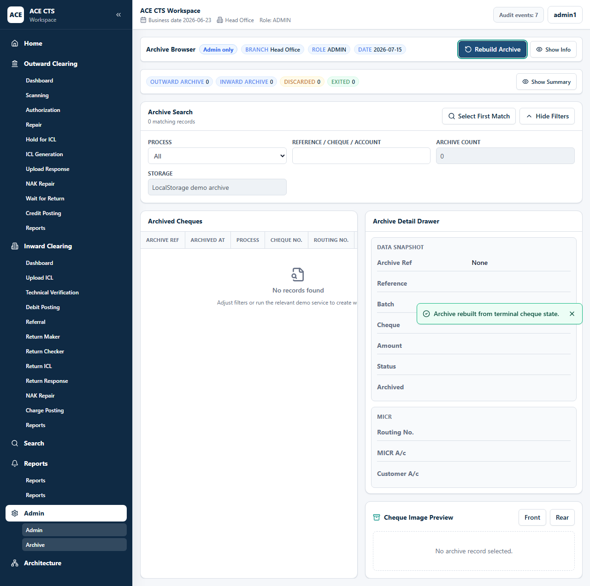

*Figure 10: ACE CTS Archive Browser (Indicative and subject to change)*

**Priority**  
High

**Integration Touch Point**  
ACE CTS shall support Bank-approved archival storage, indexing, and retrieval.

**Functional Requirement**  
ACE CTS shall provide the Archival function as described in this section and shall enforce the applicable workflow, validation, audit, and role controls.

**Actors**  
Admin

**Field Details / Control Behaviour**  
| S. No. | Field Name | Field Type | Control Behaviour | Mandatory | Remarks |
| --- | --- | --- | --- | --- | --- |
| 1 | Archive Search | Search criteria | Editable | No | Process and reference filters |
| 2 | Archive Count | Display | Read-only | No | Number of archived records |

**Options / Buttons**  
| S. No. | Option / Button | Behaviour | Validation / Confirmation | Target Work-step |
| --- | --- | --- | --- | --- |
| 1 | Rebuild Archive | Rebuilds archive index from completed records | Admin access required | Archive Browser |

**Validation Rules**  
Only completed, exited, or discarded items shall be archived.

**Confirmation Messages**  
ACE CTS shall display confirmation messages before committing irreversible or workflow-moving actions where indicated in the options table.

**Target Work-step(s)**  
| Routing Criteria | Target Work-step |
| --- | --- |
| Archived record selected | Archive detail |

**Audit Trail Requirement**  
Archive rebuild and record access shall be audited.

#### 3.6.3 Scanners
ACE CTS shall integrate with cheque scanner stations for front, rear, grey, and UV image capture where supported by Bank-approved hardware. Scanner model, driver, endorsement, and image specifications shall be finalized with the Bank.

### 3.6.4 Search Interface

**Description**  
ACE CTS shall provide a general cheque search with process, routing, MICR, cheque, customer account, amount, date, and endorsement filters.

**Screenshot / Figure**  
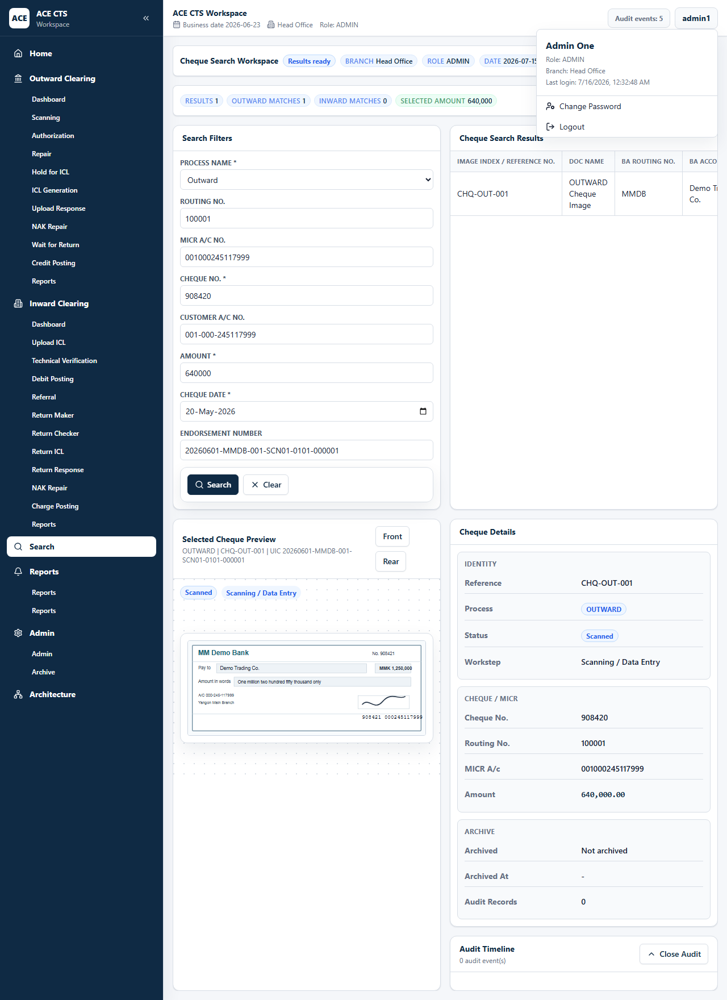

*Figure 5: ACE CTS Cheque Search (Indicative and subject to change)*

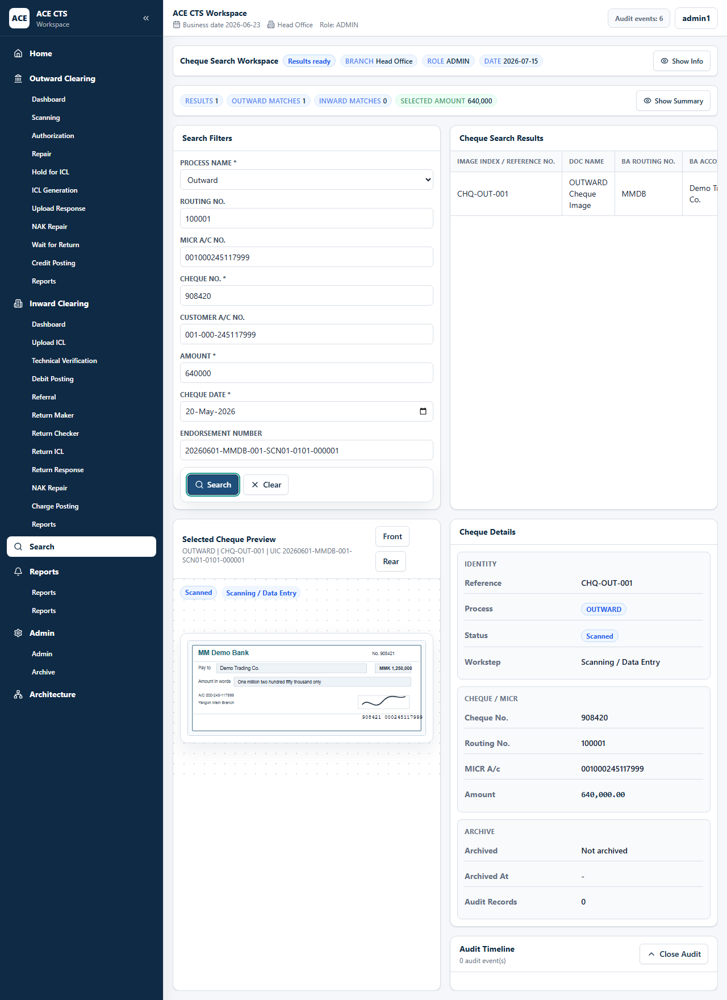

*Figure 6: ACE CTS Cheque Search Image Viewer (Indicative and subject to change)*

**Priority**  
High

**Integration Touch Point**  
ACE CTS shall search indexed cheque and archive records according to retention policy.

**Functional Requirement**  
ACE CTS shall provide the Search Interface function as described in this section and shall enforce the applicable workflow, validation, audit, and role controls.

**Actors**  
Maker, Checker, Admin

**Field Details / Control Behaviour**  
| S. No. | Field Name | Field Type | Control Behaviour | Mandatory | Remarks |
| --- | --- | --- | --- | --- | --- |
| 1 | Process Name | List | Selectable | No | All, outward, inward |
| 2 | Routing No. / MICR A/c No. / Cheque No. | Text | Editable | Conditional | Search identifiers |
| 3 | Customer A/c No. / Amount / Cheque Date / Endorsement Number | Text/date | Editable | Conditional | Additional filters |

**Options / Buttons**  
| S. No. | Option / Button | Behaviour | Validation / Confirmation | Target Work-step |
| --- | --- | --- | --- | --- |
| 1 | Search | Runs search and displays result grid | At least one useful criterion should be supplied by policy | Search Result |
| 2 | Clear | Clears criteria | None | Search |

**Validation Rules**  
Search criteria shall be applied exactly to available cheque records.

**Confirmation Messages**  
ACE CTS shall display confirmation messages before committing irreversible or workflow-moving actions where indicated in the options table.

**Target Work-step(s)**  
| Routing Criteria | Target Work-step |
| --- | --- |
| Result selected | Cheque image viewer |

**Audit Trail Requirement**  
Search and image viewing may be audited based on Bank policy.

#### 3.6.5 Dashboard
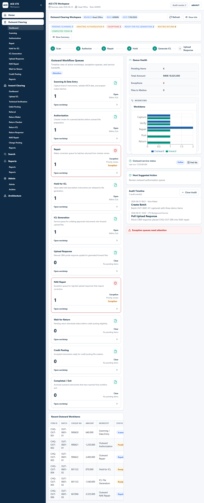

*Figure 2: ACE CTS Home Dashboard (Indicative and subject to change)*

ACE CTS shall provide dashboard views showing workitem counts, workflow navigation, charts, and recent workitems for authorized users.

#### 3.6.6 Purging & Indexing
ACE CTS shall support purge, index, and archival policies defined by the Bank. Retention duration, storage tier, restore process, and legal hold rules shall be finalized with the Bank.

### 3.6.7 Admin Module

**Description**  
ACE CTS shall provide user management, role assignment, queue visibility, settings, audit log, service controls, archive access, and reset functions.

**Screenshot / Figure**  
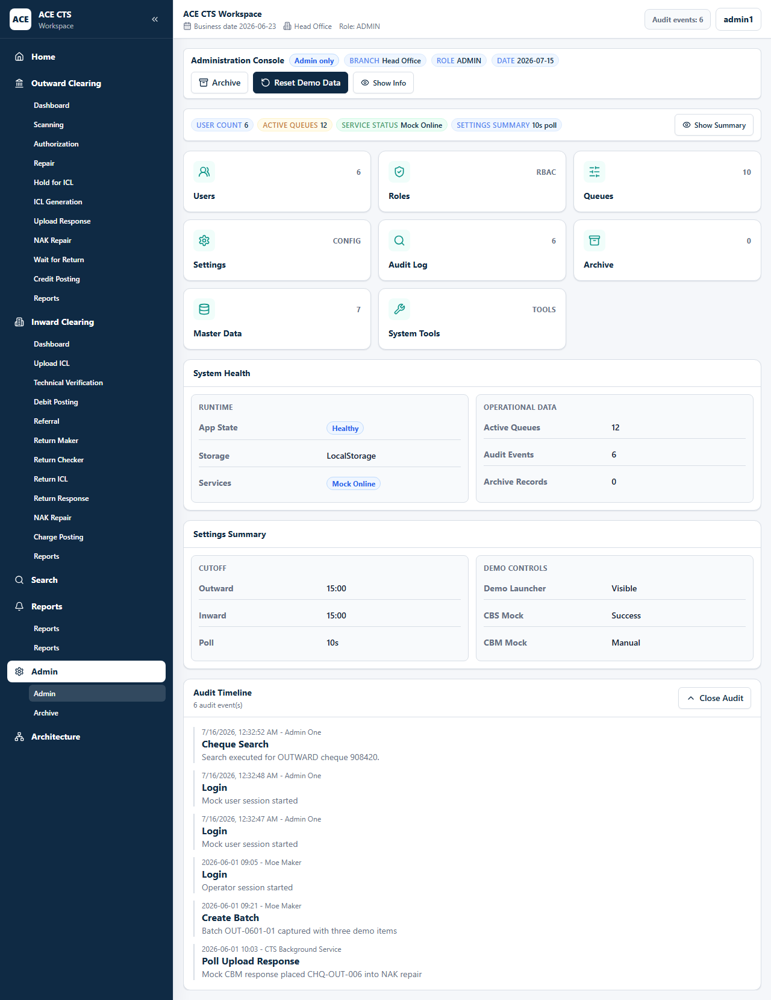

*Figure 7: ACE CTS Admin Dashboard (Indicative and subject to change)*

*Figure 8: ACE CTS Admin Settings (Indicative and subject to change)*

*Figure 9: ACE CTS Audit Log (Indicative and subject to change)*

**Priority**  
High

**Integration Touch Point**  
ACE CTS shall support Bank-defined user, role, queue, parameter, and system-administration controls.

**Functional Requirement**  
ACE CTS shall provide the Admin Module function as described in this section and shall enforce the applicable workflow, validation, audit, and role controls.

**Actors**  
Admin

**Field Details / Control Behaviour**  
| S. No. | Field Name | Field Type | Control Behaviour | Mandatory | Remarks |
| --- | --- | --- | --- | --- | --- |
| 1 | Users and Role Assignment | Grid/list | Editable by admin | Yes | User role and status |
| 2 | Queue Access Management | Display | Read-only | No | Role-based queue access |
| 3 | Application Settings | Configuration | Editable by admin | Yes | Cutoff, poll interval, representment, routing, CBS/CBM settings |
| 4 | Audit Log | Grid | Read-only | No | Audit events |

**Options / Buttons**  
| S. No. | Option / Button | Behaviour | Validation / Confirmation | Target Work-step |
| --- | --- | --- | --- | --- |
| 1 | Save Settings | Saves configuration changes | Valid values required | Admin |
| 2 | Reset Demo Data | Restores configured seed state | Admin confirmation policy recommended | Admin |
| 3 | Rebuild Archive | Rebuilds archive index | Admin access required | Archive |
| 4 | Archive | Opens archive browser | None | Archive Browser |

**Validation Rules**  
Only administrators shall access admin functions. Settings shall be validated before saving.

**Confirmation Messages**  
ACE CTS shall display confirmation messages before committing irreversible or workflow-moving actions where indicated in the options table.

**Target Work-step(s)**  
| Routing Criteria | Target Work-step |
| --- | --- |
| Settings saved | Admin |
| Archive selected | Archive Browser |

**Audit Trail Requirement**  
User role updates, settings changes, archive rebuild, reset, and admin service actions shall be audited.

#### 3.6.8 Audit Trail
ACE CTS shall capture user, role, timestamp, action, entity reference, and remarks for configured user and service actions. Audit logs shall support administration, investigation, and compliance review.

#### 3.6.9 Role and Queue Management
ACE CTS shall restrict page and queue access by role and assigned workflow. Maker, Checker, Admin, and Service access shall follow Bank-approved user administration policy.

#### 3.6.10 Configuration and Settings
ACE CTS shall allow authorized administrators to maintain cutoff times, service polling interval, representment count and days, valid routing numbers, CBS settings, Clearing House / CBM response handling, charge posting requirement, reject reasons, and queue access configuration.

## 4. External Interface Requirements

### 4.1 User Interfaces
ACE CTS shall provide role-based user interfaces for outward, inward, reporting, search, archive, administration, audit, and architecture functions. User interface captions and layouts are indicative and subject to change.

### 4.2 Hardware Interfaces
ACE CTS shall integrate with Bank-approved cheque scanner stations for image capture and endorsement. Scanner model, driver, network, UV image, rear image, greyscale image, IQA, and endorsement details shall be finalized with the Bank.

### 4.3 Software Interfaces
ACE CTS shall integrate with CBS for account lookup, account status, balance, signature, debit posting, credit posting, and charge posting. ACE CTS shall exchange ICL and response files with Clearing House / CBM. File format, file naming, encryption, signing, acknowledgement, error handling, and transport specifications shall be finalized with the Bank.

### 4.4 Communications Interfaces
ACE CTS shall use Bank-approved secure communication channels for user access, scanner station connectivity, CBS integration, Clearing House / CBM file exchange, administrative access, and DR replication.

## 5. Other Nonfunctional Requirements

### 5.1 Performance Requirements
- ACE CTS shall support operational work queues with responsive search, capture, verification, authorization, and reporting screens.
- ACE CTS shall generate clearing and posting files within Bank-defined service windows.
- ACE CTS shall support configurable service polling intervals and cutoff processing.

### 5.2 Security and Safety Requirements
- ACE CTS shall enforce authentication, authorization, maker-checker segregation, secure session handling, and administrator-only access to sensitive configuration.
- ACE CTS shall protect cheque images, account details, audit logs, reports, and interface files according to Bank information security policy.
- ACE CTS shall retain audit evidence for user actions, service actions, file generation, response processing, posting, and administrative changes.

### 5.3 Software Quality Attributes
- ACE CTS shall be maintainable, configurable, auditable, secure, resilient, and operationally observable.
- ACE CTS shall support backup, recovery, DR, archival, and purge requirements confirmed with Bank IT.
- ACE CTS shall provide clear validation messages and prevent unauthorized workflow movement.

## 6. Appendix A: Deployment Diagram

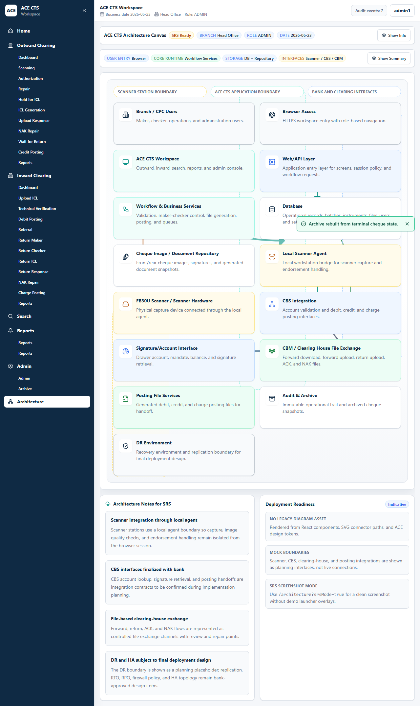

*Figure 11: ACE CTS Architecture Canvas (Indicative and subject to change)*

ACE CTS target deployment shall include branch/CPC users using HTTPS access, web/application/database tiers, scanner stations, administrator access, CBS integration, Clearing House / CBM file exchange, and DR capability. Final infrastructure, high availability, active/passive design, recovery time objective, recovery point objective, firewall policy, certificate policy, and monitoring shall be confirmed with Bank IT.

## 7. Appendix B: Open Items
| S. No. | Open Item | Owner | Resolution Requirement |
| --- | --- | --- | --- |
| 1 | CBS account, signature, debit, credit, and charge posting interface specification | Bank / ACE Technology | Finalize before interface build |
| 2 | Clearing House / CBM ICL and response file specification | Bank / ACE Technology | Finalize file format, path, security, and response handling |
| 3 | Scanner hardware and driver specification | Bank | Confirm models, image modes, endorsement, IQA |
| 4 | HA/DR and infrastructure topology | Bank IT | Confirm production architecture |
| 5 | Retention, purge, and archival policy | Bank | Confirm retention and legal requirements |

## 8. Appendix C: Integration Touch Points
| Touch Point | Requirement |
| --- | --- |
| CBS Account Lookup | ACE CTS shall fetch account name, status, branch, balance, and signature/mandate data from CBS or Bank-approved systems. |
| CBS Posting | ACE CTS shall generate and/or exchange debit, credit, and charge posting data with CBS. |
| Clearing House / CBM | ACE CTS shall exchange outward forward upload, inward forward download, return upload, acknowledgement, and negative acknowledgement files. |
| Scanner Stations | ACE CTS shall capture front, rear, grey, UV, MICR, IQA, and endorsement data from scanner stations. |
| Reports and Archive | ACE CTS shall provide report exports and archived cheque retrieval according to Bank policy. |

## 9. Appendix D: List of Reject Reasons
| Code | Description | Applies To |
| --- | --- | --- |
| R01 | Insufficient Funds | Inward |
| R02 | Signature Mismatch | Both |
| R03 | Stale Cheque | Both |
| R04 | Duplicate Cheque | Both |
| R05 | Invalid MICR | Outward |
| R06 | Image Quality Failed | Both |
| R07 | Account Closed | Inward |

## 10. Appendix E: Account Types and Status
| Type / Status | Usage |
| --- | --- |
| Active | Eligible account status subject to available balance and Bank rules |
| Dormant | Requires Bank-defined handling and possible referral or reject |
| Inactive | Requires Bank-defined handling and possible reject |
| Closed | Reject or return according to Bank rules |
| Normal Cheque | Standard cheque verification path |
| PO Cheque | PO-specific handling may hide balance and signature details where applicable |

## 11. Appendix F: New Reports

### Outward Reports
- Outward Summary Report
- Outward Return Report
- Negative Acknowledgement Report
- Outward Discard Cheques Report
- Cheque Introduced in the System
- Outward Cheque Honored
- CB Accepted Cheques
- Return Advice Generation

### Inward Reports
- Inward Introduction Report
- Inward Summary Report
- Inward Clearing Report Referral
- Inward Clearing Report
- Inward Return Report
- Auto Return Report
- Inward NAK Report
- Inward Pending Report

## 12. User Listing Requirement
| Role / Queue | Required Access |
| --- | --- |
| MAKER | Outward scanning, outward repair, technical verification, manual return maker, outward NAK repair, inward NAK repair, upload ICL |
| CHECKER | Outward authorization, referral, manual return checker |
| ADMIN | All functional pages, admin settings, audit trail, archive, reset, role and queue management |
| SERVICE | Background service identity for scheduled audit events and interface processing |
